##### EDA Report — Instacart Market Basket Analysis

Báo cáo này ghi lại kết quả kiểm tra dữ liệu thô trong `data/`:

0. Tổng quan về dataset.
1. Tách `orders.csv` theo `eval_set` và thống kê số lượng.
2. Kiểm tra tỉ lệ missing values trên từng cột của mọi file.
3. Phân phối số đơn hàng trên mỗi khách hàng.
4. Phân phối ngày và giờ đặt hàng.
5. Khoảng thời gian giữa hai đơn liên tiếp.
6. Phân phối kích thước giỏ hàng.
7. Biến động kích thước giỏ qua các đơn liên tiếp.
8. Sản phẩm phổ biến.
9. Nhóm hàng (department/aisle) phổ biến.
10. Phân phối độ phổ biến và long-tail của sản phẩm.
11. Độ đa dạng sản phẩm theo khách hàng.
12. Hành vi mua lại theo sản phẩm, aisle và department.
13. Tần suất mua và xác suất mua lại ở đơn kế tiếp.
14. Recency và xác suất mua lại.
15. Các sản phẩm xuất hiện cùng nhau.
16. Độ phổ biến sản phẩm theo department.
17. Sản phẩm được thêm vào giỏ đầu tiên.
18. Kích thước giỏ theo ngày và giờ đặt hàng.
19. Hồ sơ hành vi theo khách hàng.
20. Nhóm hành vi khách hàng (phân vị tần suất và PCA).
21. Tỉ lệ mua lại theo order_number và khoảng cách đơn trước.
22. Cặp department cùng xuất hiện trong giỏ.
23. Support và lift của cặp sản phẩm.
24. File sinh ra.

---

## 0. Tổng quan về dataset

Dữ liệu là bộ Instacart Market Basket Analysis, ghi lại lịch sử đặt hàng tạp hoá trực tuyến của khách hàng Instacart. Dữ liệu đã được ẩn danh: không có thông tin cá nhân của khách, không có giá sản phẩm và không có ngày tháng cụ thể — thời gian chỉ được mô tả bằng thứ tự đơn (`order_number`), ngày trong tuần, giờ trong ngày và số ngày kể từ đơn trước.

Snapshot gốc gồm 6 file CSV trong `data/`:

| File                        | Số dòng    | Số cột | Dung lượng | Mô tả                                                             |
| --------------------------- | ----------:| ------:| ----------:| ----------------------------------------------------------------- |
| `orders.csv`                | 3.421.083  | 7      | 109 MB     | Mỗi dòng là một đơn hàng                                          |
| `order_products__prior.csv` | 32.434.489 | 4      | 578 MB     | Sản phẩm trong các đơn `prior` (mỗi dòng là một cặp đơn–sản phẩm) |
| `order_products__train.csv` | 1.384.617  | 4      | 24,7 MB    | Sản phẩm trong các đơn `train`                                    |
| `products.csv`              | 49.688     | 4      | 2,2 MB     | Danh mục sản phẩm                                                 |
| `aisles.csv`                | 134        | 2      | 2,6 KB     | Danh mục aisle (nhóm hàng chi tiết)                               |
| `departments.csv`           | 21         | 2      | 270 B      | Danh mục department (nhóm hàng lớn)                               |

Số dòng không tính header.

### 0.1. Quy mô bảng và số thực thể

- **Số thực thể**: 49.688 sản phẩm trong `products.csv` (49.677 sản phẩm xuất hiện ít nhất một lần trong `order_products__prior.csv`), 134 aisle và 21 department.
- **Số sản phẩm trong catalog theo department**: personal care 6.563, snacks 6.264, pantry 5.371, beverages 4.365, frozen 4.007, dairy eggs 3.449, household 3.085, canned goods 2.092, dry goods pasta 1.858, produce 1.684, bakery 1.516, deli 1.322, missing 1.258, international 1.139, breakfast 1.115, babies 1.081, alcohol 1.054, pets 972, meat seafood 907, other 548, bulk 38.

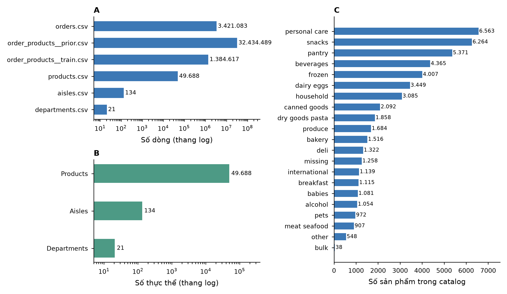

*Figure 17. A: số dòng của 6 file CSV (thang log). B: số sản phẩm, aisle và department (thang log). C: số sản phẩm trong catalog theo department.*

Nhận xét: 

- `order_products__prior.csv` là bảng lớn nhất (32.434.489 dòng), gấp khoảng 9,5 lần `orders.csv`, nên cần đọc theo chunk hoặc chỉ chọn cột cần thiết khi xử lý.
- Có 11 sản phẩm (49.688 − 49.677) có trong catalog nhưng chưa từng xuất hiện trong đơn `prior`.
- Số sản phẩm trong catalog không tỉ lệ với mức độ được mua: personal care, snacks, pantry có nhiều sản phẩm nhất (5.371 – 6.563), trong khi produce chỉ có 1.684 sản phẩm nhưng chiếm 29,23% số dòng (mục 9).
- Có một department tên `missing` với 1.258 sản phẩm — đây là sản phẩm chưa được phân loại, cần lưu ý khi phân tích theo department.

### 0.2. Mô tả các cột

`orders.csv`

| Cột                      | Kiểu  | Miền giá trị       | Ý nghĩa                                                     |
| ------------------------ | ----- | ------------------ | ----------------------------------------------------------- |
| `order_id`               | int   | 1 – 3.421.083      | Mã đơn hàng (khoá chính)                                    |
| `user_id`                | int   | 1 – 206.209        | Mã khách hàng                                               |
| `eval_set`               | text  | prior, train, test | Tập dữ liệu mà đơn thuộc về                                 |
| `order_number`           | int   | 1 – 100            | Thứ tự đơn của khách (1 = đơn đầu tiên)                     |
| `order_dow`              | int   | 0 – 6              | Ngày trong tuần (mã số, không có nhãn tên ngày)             |
| `order_hour_of_day`      | int   | 0 – 23             | Giờ đặt hàng                                                |
| `days_since_prior_order` | float | 0 – 30, có NaN     | Số ngày kể từ đơn trước; chặn trên ở 30; NaN ở đơn đầu tiên |

`order_products__prior.csv` và `order_products__train.csv` (cùng cấu trúc)

| Cột                 | Kiểu | Miền giá trị                    | Ý nghĩa                                                 |
| ------------------- | ---- | ------------------------------- | ------------------------------------------------------- |
| `order_id`          | int  | tham chiếu `orders`             | Mã đơn hàng                                             |
| `product_id`        | int  | tham chiếu `products`           | Mã sản phẩm                                             |
| `add_to_cart_order` | int  | 1 – 145 (prior), 1 – 80 (train) | Thứ tự sản phẩm được thêm vào giỏ                       |
| `reordered`         | int  | 0 / 1                           | 1 nếu khách đã từng mua sản phẩm này ở một đơn trước đó |

`products.csv`, `aisles.csv`, `departments.csv`

| Bảng          | Cột                                                       | Ý nghĩa                                        |
| ------------- | --------------------------------------------------------- | ---------------------------------------------- |
| `products`    | `product_id`, `product_name`, `aisle_id`, `department_id` | Tên sản phẩm và nhóm hàng mà sản phẩm thuộc về |
| `aisles`      | `aisle_id`, `aisle`                                       | Tên aisle (ví dụ: fresh fruits, yogurt)        |
| `departments` | `department_id`, `department`                             | Tên department (ví dụ: produce, dairy eggs)    |

### 0.3. Quan hệ giữa các bảng

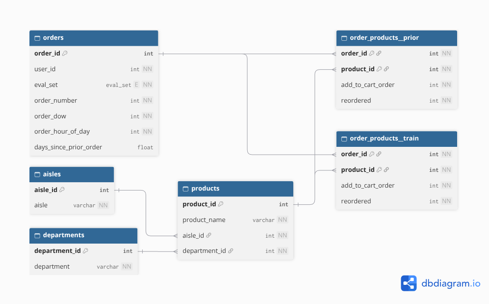

*Sơ đồ quan hệ thực thể giữa các bảng trong cơ sở dữ liệu.*

- `orders` là bảng trung tâm; mỗi đơn liên kết với nhiều dòng sản phẩm qua `order_id`.
- `order_products__*` là bảng nối giữa `orders` và `products` (khoá chính ghép `(order_id, product_id)`, không có cặp trùng).
- `products` liên kết với `aisles` qua `aisle_id` và với `departments` qua `department_id`.
- Không có bảng khách hàng riêng: `user_id` chỉ xuất hiện trong `orders`. Cặp `(user_id, order_number)` là duy nhất.
- Mọi `order_id` và `product_id` trong hai bảng `order_products__*` đều tồn tại trong `orders` và `products`.

Sơ đồ đầy đủ (DBML) nằm ở `docs/schema.dbml`, có thể render tại https://dbdiagram.io/d.

### 0.4. Cách chia `eval_set`

- Mỗi khách có lịch sử gồm 3 – 99 đơn `prior` và đúng 1 đơn cuối thuộc `train` hoặc `test`.
- 131.209 khách có đơn cuối thuộc `train`: sản phẩm của đơn này có trong `order_products__train.csv`.
- 75.000 khách có đơn cuối thuộc `test`: sản phẩm của đơn này bị ẩn (không có file `order_products__test`).
- `order_products__prior.csv` chỉ chứa đơn `prior`, `order_products__train.csv` chỉ chứa đơn `train`.

---

## 1. Tách `orders.csv` theo `eval_set`

`orders.csv` có 3.421.083 dòng (chưa tính header), 7 cột:
`order_id, user_id, eval_set, order_number, order_dow, order_hour_of_day, days_since_prior_order`.

Đã tách thành 3 file CSV riêng theo giá trị `eval_set`:

| File                    | `eval_set` | Số đơn hàng   | Tỉ lệ  |
| ----------------------- | ---------- | -------------:| ------:|
| `data/orders_prior.csv` | prior      | 3.214.874     | 93.97% |
| `data/orders_train.csv` | train      | 131.209       | 3.83%  |
| `data/orders_test.csv`  | test       | 75.000        | 2.19%  |
| **Tổng**                |            | **3.421.083** | 100%   |

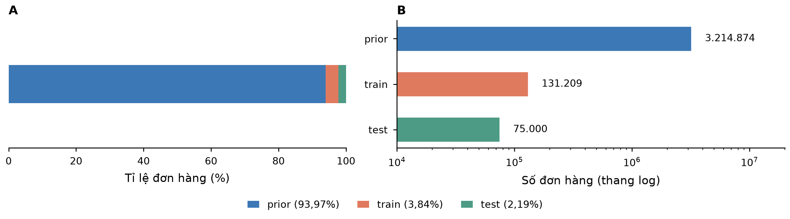

*Figure 1. Số đơn hàng theo `eval_set` (trục log). `prior` chiếm 94% dữ liệu.*

Nhận xét: `prior` chiếm gần như toàn bộ dữ liệu (94%) — đây là phần lịch sử mua hàng dùng để xây dựng feature. `train` (131.209 đơn) là các đơn cuối *có nhãn* để học/đánh giá; `test` (75.000 đơn) là các đơn cuối *bị ẩn sản phẩm*, chỉ dùng khi nộp Kaggle.

---

## 2. Missing values

Đã quét toàn bộ 6 file (file lớn đọc theo chunk 2 triệu dòng để tiết kiệm RAM).

Kết luận: chỉ có duy nhất 1 cột chứa giá trị thiếu.

| File         | Cột                      | Số dòng   | Missing | Tỉ lệ     |
| ------------ | ------------------------ | ---------:| -------:| ---------:|
| `orders.csv` | `days_since_prior_order` | 3.421.083 | 206.209 | **6.03%** |

Các cột còn lại (toàn bộ `products.csv`, `aisles.csv`, `departments.csv`, `order_products__prior.csv`, `order_products__train.csv`, và các cột khác của `orders.csv`) đều không có missing value.

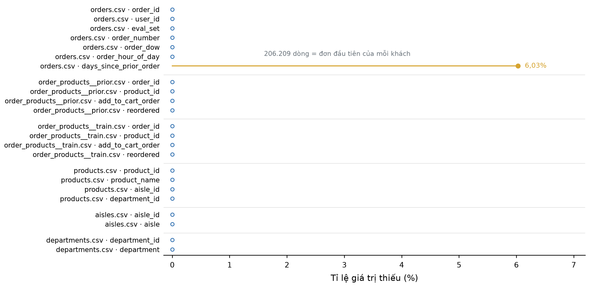

*Figure 2. Tỉ lệ missing theo từng cột (cam = có missing, xanh dương = đầy đủ).*

Giải thích:

- 206.209 giá trị thiếu = đúng số khách hàng trong dataset. `days_since_prior_order` là số ngày kể từ đơn trước, nên đơn đầu tiên của mỗi khách không có đơn trước → luôn là NaN. Đây là structural missing, không phải lỗi dữ liệu.

---

## 3. Phân phối số đơn hàng trên mỗi khách hàng

Thống kê trên 206.209 khách hàng:

| Chỉ số               | Giá trị |
| -------------------- | -------:|
| Số khách hàng        | 206.209 |
| Min                  | 4       |
| Max                  | 100     |
| Mean                 | 16.59   |
| Median               | 10      |
| Q1 (25%)             | 6       |
| Q3 (75%)             | 20      |
| Std                  | 16.65   |
| Mode (phổ biến nhất) | 4       |

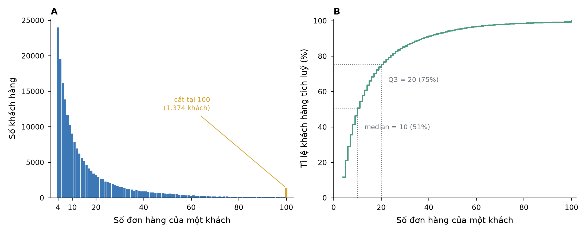

*Figure 3. Phân phối số đơn trên mỗi khách (n = 206.209 khách, `orders.csv`). A: histogram số đơn; B: ECDF với median và Q3.*

Nhận xét:

- Phân phối lệch phải mạnh: phần lớn khách chỉ có ít đơn, một nhóm nhỏ mua rất nhiều lần.
- Giá trị phổ biến nhất là 4 đơn (23.986 khách).
- 21.13% khách có ≤ 5 đơn; 50.68% khách có ≤ 10 đơn; chỉ 5.29% khách có > 50 đơn.
- Cột mốc tại 100 là do dữ liệu bị cắt: có 1,374 khách đạt ít nhất 100 đơn.
- Vì mật độ quan sát mỗi khách rất khác nhau, các đặc trưng hành vi (tần suất, basket size…) nên chuẩn hoá theo số đơn để so sánh công bằng.

---

## 4. Ngày và giờ đặt hàng

Nguồn: `data/orders_prior.csv` — 3.214.874 đơn `prior`.

| Mã ngày       | 0     | 1     | 2     | 3     | 4     | 5     | 6     |
| ------------- | -----:| -----:| -----:| -----:| -----:| -----:| -----:|
| Tỉ lệ đơn (%) | 17.35 | 17.32 | 13.75 | 12.83 | 12.48 | 13.25 | 13.03 |

- Ngày có tỉ lệ đơn cao nhất: mã 0 (17.35%); thấp nhất: mã 4 (12.48%).
- Giờ có tỉ lệ đơn cao nhất: 10 (8.46%); thấp nhất: 3 (0.16%).
- Khung 9–16 giờ chiếm 64.96% số đơn; khung 0–5 giờ chiếm 1.84%.
- Ô (ngày, giờ) có tỉ lệ đơn cao nhất: ngày 1, giờ 10 (1.65%).

Nhận xét: 

- `orders.csv` chỉ encode ngày trong tuần bằng số nguyên 0–6. Nên chưa xác nhận được cụ thể 0-6 tương ứng với ngày bao nhiêu trong tuần.
- Tuy nhiên, khi xét giờ cao điểm của từng ngày, ngày 0 và ngày 6 có đỉnh vào lúc 14 giờ, còn các ngày 1–5 đều có đỉnh vào lúc 10 giờ. Kết hợp với mục 18 (ngày 0 và 6 có giỏ hàng lớn nhất, median 9 item), cũng có khả năng ngày 0 và 6 mới là hai ngày cuối tuần (chủ nhật và thứ 7), còn ngày 1 (thứ 2) đông đơn do khách mua bổ sung đầu tuần. Cần thêm thông tin để kết luận chắc chắn.
- Biểu đồ B cho thấy lượng đơn tăng nhanh từ 6–7 giờ sáng, đạt đỉnh ở 10 giờ (8.46%) và giữ ở mức khoảng 8% cho đến 16 giờ, sau đó giảm dần vào buổi tối. Khung 9–16 giờ chiếm gần 2/3 (64.96%) số đơn.
- Khung đêm khuya 0–5 giờ gần như không có đơn (1.84%); giờ thấp nhất (3 giờ, 0.16%) thấp hơn giờ cao nhất khoảng 53 lần. Khách hàng chủ yếu đặt hàng vào ban ngày.
- Ô có tỉ lệ đơn cao nhất là ngày 1 lúc 10 giờ (1.65%); vùng đậm màu trên biểu đồ C tập trung ở ngày 0, 1 trong khung 9–16 giờ.

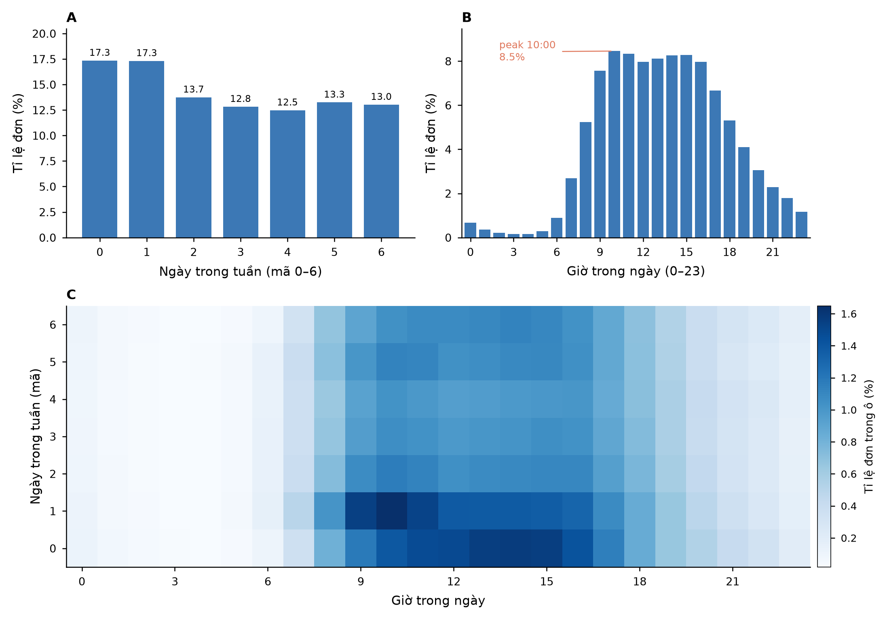

*Figure 4. Thời điểm đặt hàng (n = 3.214.874 đơn `prior`). A: tỉ lệ đơn theo mã ngày 0–6. B: tỉ lệ đơn theo giờ 0–23. C: tỉ lệ đơn theo từng ô ngày × giờ.*

---

## 5. Khoảng thời gian giữa hai đơn liên tiếp

`days_since_prior_order` là số ngày kể từ đơn trước. Đơn đầu tiên của mỗi khách không có đơn trước nên trường này là NaN (206.209 đơn), không phải 0.

| Chỉ số                 | Giá trị        |
| ---------------------- | --------------:|
| Đơn `prior`            | 3.214.874      |
| Đơn đầu tiên (NaN)     | 206.209        |
| Chuyển tiếp có giá trị | 3.008.665      |
| Mean                   | 10.71          |
| Median                 | 7              |
| Q1 (25%)               | 4              |
| Q3 (75%)               | 15             |
| Chuyển tiếp 0 ngày     | 64.436 (2.14%) |
| Chuyển tiếp ≤ 7 ngày   | 51.90%         |
| Chuyển tiếp = 30 ngày  | 10.18%         |

Giá trị 0 là hai đơn được đặt trong cùng một ngày, khác với đơn đầu tiên (NaN). 30 là giá trị lớn nhất được mã hoá trong dữ liệu.

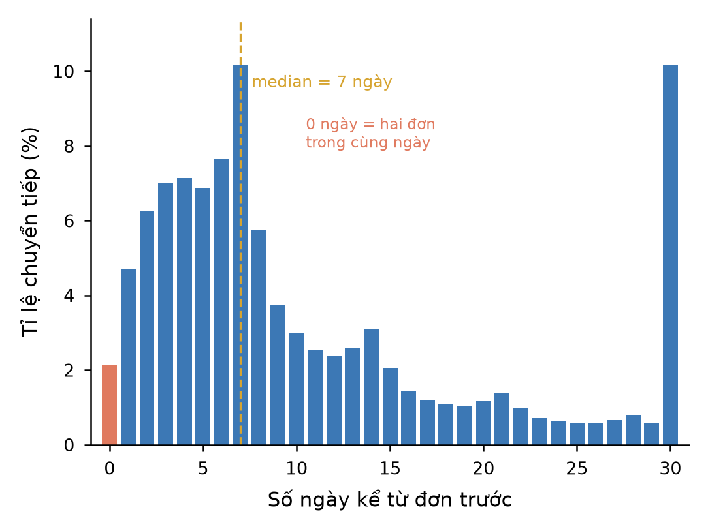

*Figure 5. Phân phối số ngày kể từ đơn trước (n = 3.008.665 chuyển tiếp; loại 206.209 đơn đầu tiên có NaN). Cột cam là 0 ngày; đường nét đứt là median.*

Nhận xét: 

- Có khoảng 64.436 cặp đơn (2.14%) mua trong cùng một ngày
- Phân phối có hai đỉnh rõ rệt: đỉnh ở mốc 7 ngày (10.18%) và đỉnh ở mốc 30 ngày (10.18%). Đỉnh 30 ngày bị phóng đại do 30 là giá trị chặn trên — nó gộp cả những khách quay lại sau hơn 30 ngày.
- Ngoài mốc 7 ngày, biểu đồ còn có các đỉnh nhỏ ở 14 ngày (3.09%), 21 ngày (1.37%) và 28 ngày (0.79%), cho thấy nhiều khách có thói quen mua hàng theo chu kỳ tuần (1, 2, 3 hoặc 4 tuần một lần).
- Hơn một nửa (51.90%) số lần quay lại diễn ra trong vòng 7 ngày; 50% chuyển tiếp nằm trong khoảng 4–15 ngày (Q1–Q3). Mean (10.71) lớn hơn median (7) do đuôi phải kéo dài đến mốc 30.

---

## 6. Kích thước giỏ hàng

Kích thước giỏ = số dòng order–product của một đơn trong `order_products__prior.csv`.

| Chỉ số            | Giá trị    |
| ----------------- | ----------:|
| Số đơn            | 3.214.874  |
| Tổng số item      | 32.434.489 |
| Min               | 1          |
| Max               | 145        |
| Mean              | 10.09      |
| Median            | 8          |
| Q1 (25%)          | 5          |
| Q3 (75%)          | 14         |
| Đơn có 1 item     | 4.88%      |
| Đơn có ≤ 5 item   | 31.14%     |
| Đơn có ≥ 20 item  | 10.93%     |
| Đơn không có item | 0          |

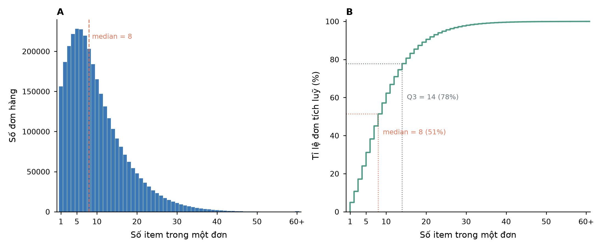

*Figure 6. Kích thước giỏ hàng (n = 3.214.874 đơn `prior`). A: histogram số item/đơn, đuôi phải gộp vào mốc 60+; B: ECDF với median và Q3.*
Nhận xét: 

- Phân phối số item trong một đơn lệch phải mạnh: phần lớn khách chỉ có một vài item trong cùng một đơn, rất ít các đơn hàng có item >= 40 (chỉ 0.50%)
- Giá trị phổ biến nhất là 5 item (228.330 đơn, 7.10%), theo sát là 6 item (227.675 đơn, 7.08%)
- Đơn chỉ có một item chiếm 4.88%; 31.14% đơn có <= 5 item; số lượng đơn trên 20 item chỉ chiếm 10.93% 
- Có hơn một nửa (51%) đơn hàng có tối đa 8 item. Ngoài ra, 78% đơn hàng có số item dao động trong khoảng từ 1-14 
- Không có đơn nào không có sản phẩm (không có đơn trống)

---

## 7. Biến động kích thước giỏ qua các đơn liên tiếp

Với mỗi khách, các đơn `prior` được sắp theo `order_number`; biến động giữa hai đơn liên tiếp là `Δ = size(t+1) − size(t)`. Chỉ tính các cặp liên tiếp nằm trong `prior`.

| Chỉ số                 | Giá trị   |
| ---------------------- | ---------:|
| Số cặp đơn liên tiếp   | 3.008.665 |
| Mean \|Δ\| (item)      | 4.72      |
| Median \|Δ\| (item)    | 3         |
| Q3 \|Δ\| (item)        | 6         |
| Cặp không đổi (Δ = 0)  | 10.68%    |
| Cặp tăng (Δ > 0)       | 44.75%    |
| Cặp giảm (Δ < 0)       | 44.57%    |
| Mean Δ                 | 0.02      |
| Tương quan lag-1 (gộp) | 0.5783    |

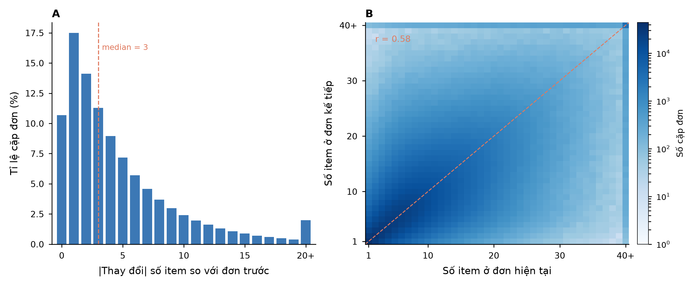

*Figure 7. Biến động kích thước giỏ giữa hai đơn liên tiếp (n = 3.008.665 cặp). A: phân phối |Δ|, đuôi phải gộp vào mốc 20+. B: mật độ số cặp theo kích thước đơn hiện tại và đơn kế tiếp (log-color scale); đường nét đứt là y = x; r là tương quan lag-1 gộp.*

Nhận xét: *cái nầy đo mức độ biến động của đơn hàng*

- Biểu đồ A  lệch phải mạnh, trong đó 10,68% hoàn toàn không thay đổi và 50% chênh lệch nhiều nhất là 3 sản phẩm.
- Sự thay đổi giữa cặp đơn liên tiếp tiếp ổn định với tỉ lệ cặp tăng tương đương với tỉ lệ cặp giảm (44.75% và 44.57%). Điều này cũng thể hiện qua trung bình các giá trị chênh lệch giữa hai đơn là 0.02. 
- Hệ số tương quan thuận (>0) thể hiện hành vi của khách hàng: nếu "Số item ở đơn hiện tại" lớn thì "Số item ở đơn kế tiếp" có xu hướng lớn. Ngược lại, Số item ở đơn hiện tại" nhỏ thì "Số item ở đơn kế tiếp" có xu hướng nhỏ theo. 
- Như trong biểu đồ B, các điểm dữ liệu tập trung dọc quanh đường chéo (đường cam), cho thấy số lượng item ở đơn kế tiếp xấp xỉ với số lượng hiện tại

---

## 8. Sản phẩm phổ biến

Có 49.677 sản phẩm xuất hiện ít nhất một lần trong `order_products__prior.csv`; tổng số dòng order–product là 32.434.489.

| Sản phẩm               | Aisle                      | Số đơn  | Tỉ lệ đơn (%) | Tỉ lệ mua lại (%) |
| ---------------------- | -------------------------- | -------:| -------------:| -----------------:|
| Banana                 | fresh fruits               | 472.565 | 1.46          | 89.97             |
| Bag of Organic Bananas | fresh fruits               | 379.450 | 1.17          | 87.68             |
| Organic Strawberries   | fresh fruits               | 264.683 | 0.82          | 82.93             |
| Organic Baby Spinach   | packaged vegetables fruits | 241.921 | 0.75          | 82.34             |
| Organic Hass Avocado   | fresh fruits               | 213.584 | 0.66          | 84.02             |
| Organic Avocado        | fresh fruits               | 176.815 | 0.55          | 82.93             |
| Large Lemon            | fresh fruits               | 152.657 | 0.47          | 73.64             |
| Strawberries           | fresh fruits               | 142.951 | 0.44          | 74.32             |
| Limes                  | fresh fruits               | 140.627 | 0.43          | 72.54             |
| Organic Whole Milk     | milk                       | 137.905 | 0.43          | 87.62             |

Top 10 sản phẩm chiếm 7.16% tổng số dòng. "Số đơn" là số dòng order–product (mỗi đơn tối đa một dòng cho mỗi sản phẩm); tỉ lệ mua lại tính trên các dòng thuộc đơn `order_number >= 2` (định nghĩa ở mục 12).

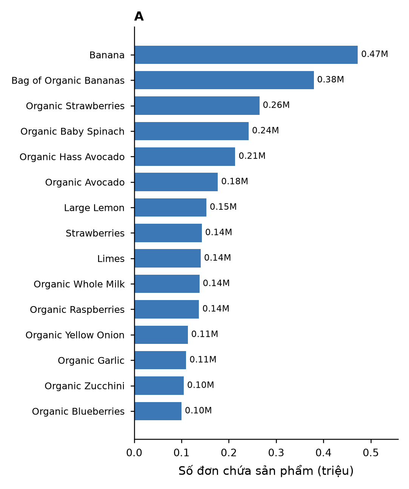

*Figure 8. Top 15 sản phẩm theo số đơn chứa sản phẩm (n = 32.434.489 dòng `prior`).*

Nhận xét: 

- Trong top 10, hầu hết là các mặt hàng rau củ, trái cây. 

- 9/10 sản phẩm thuộc nhóm tươi sống (8 sản phẩm thuộc aisle fresh fruits, 1 thuộc packaged vegetables fruits); chỉ có Organic Whole Milk thuộc aisle milk. Ngoài ra, 6/10 sản phẩm là hàng organic.

- Chuối là sản phẩm nổi bật nhất: Banana và Bag of Organic Bananas lần lượt đứng nhất và nhì, cộng lại chiếm 2.63% tổng số dòng.

- Dù top 10 chỉ chiếm 7.16% tổng số dòng, tỉ lệ mua lại của chúng đều rất cao (72.54% – 89.97%), cao hơn tỉ lệ mua lại gộp (63.01%, mục 12). Đây là những mặt hàng thiết yếu được mua lặp lại thường xuyên.

  ---

## 9. Nhóm hàng phổ biến

| Department | Tỉ lệ đơn (%) | Tỉ lệ mua lại (%) |
| ---------- | -------------:| -----------------:|
| produce    | 29.23         | 69.26             |
| dairy eggs | 16.69         | 71.39             |
| snacks     | 8.90          | 61.26             |
| beverages  | 8.29          | 69.69             |
| frozen     | 6.90          | 58.32             |

Hai department lớn nhất (produce và dairy eggs) chiếm 45.92% số dòng. Ở cấp aisle, ba aisle lớn nhất là fresh fruits (11.23%), fresh vegetables (10.54%) và packaged vegetables fruits (5.44%).

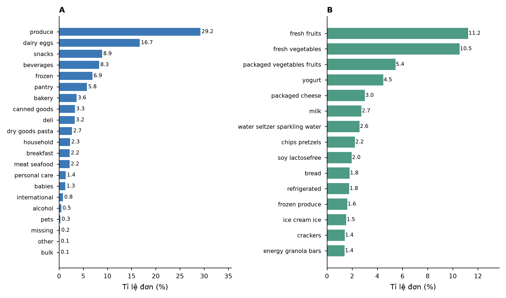

*Figure 9. A: tỉ lệ đơn theo department (21 nhóm). B: 15 aisle có tỉ lệ đơn cao nhất. Tỉ lệ tính trên 32.434.489 dòng `prior`.*

Nhận xét: 

- Phân bố giữa các department không đồng đều: chỉ riêng produce đã chiếm 29.23% số dòng, gần gấp đôi department đứng thứ hai (dairy eggs, 16.69%). Hai department này cộng lại chiếm gần một nửa (45.92%).
- Từ department thứ 3 trở đi, tỉ lệ giảm nhanh (snacks 8.90%, beverages 8.29%, frozen 6.90%) — biểu đồ A có dạng đuôi dài tương tự như ở cấp sản phẩm.
- Ở cấp aisle, fresh fruits và fresh vegetables cộng lại đã chiếm 21.77% số dòng, khớp với kết quả mục 8 khi phần lớn top sản phẩm là rau củ, trái cây.
- Trong 5 department lớn nhất, frozen có tỉ lệ mua lại thấp nhất (58.32%), còn dairy eggs cao nhất (71.39%).

---

## 10. Phân phối độ phổ biến và long-tail

| Chỉ số                             | Giá trị                   |
| ---------------------------------- | -------------------------:|
| Sản phẩm có ít nhất 1 đơn          | 49.677                    |
| Gini của số đơn theo sản phẩm      | 0.8738                    |
| Top 1% sản phẩm chiếm              | 42.80% số dòng            |
| Top 5% sản phẩm chiếm              | 69.85% số dòng            |
| Top 10% sản phẩm chiếm             | 81.43% số dòng            |
| Top 20% sản phẩm chiếm             | 90.97% số dòng            |
| Số sản phẩm cần để đạt 80% số dòng | 4.538 (9.14% số sản phẩm) |

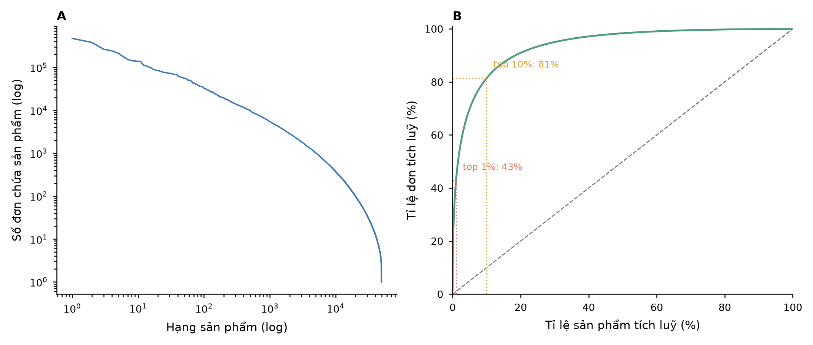

*Figure 10. A: rank–frequency của số đơn theo sản phẩm (log–log). B: đường Lorenz (sản phẩm xếp giảm dần theo số đơn); đường nét đứt là phân phối đều.*

Nhận xét: 

- Hệ số Gini bằng 0.8738 cho thấy mức độ đóng góp vào tổng giá trị đơn hàng của các sản phẩm là khác nhai. 
- Biểu đồ B có đường Lorenz cong và lệch hẳn với đường phân phối đều (màu cam) càng củng cố thêm lập luận ở trên về sự mất cân bằng này. Chỉ một phần nhỏ sản phẩm đầu danh sách chiếm giữ phần lớn tổng số đơn hàng. 
- Top 1% sản phẩm chiếm tới 42.80% tổng số đơn hàng. Và chỉ cần 9.14% số sản phẩm (4.538 sản phẩm) hoặc top 10% (chiếm 81.43%) đã đóng góp hơn 80% tổng số đơn. Top 20% thậm chí kiểm soát đến 90.97% số đơn. Tức là hãng có một nhóm sản phẩm cốt lõi mang lại doanh thu chính. 
- Dữ liệu có hiệu ứng longtail, thể hiện qua biểu đồ A có đường cong dốc xuống. Phần lớn sản phẩm có số lượng đơn hàng rất thấp. Tổng số sản phẩm có ít nhất 1 đơn là 49.677 nhưng chúng đóng góp rất ít voaf doanh số bán hàng.

---

## 11. Độ đa dạng sản phẩm theo khách hàng

Độ đa dạng = số sản phẩm khác nhau mà một khách đã mua trong các đơn `prior`.

| Chỉ số                                | Giá trị |
| ------------------------------------- | -------:|
| Số khách                              | 206.209 |
| Median số đơn/khách (prior)           | 9       |
| Mean số sản phẩm khác nhau            | 64.54   |
| Median                                | 48      |
| Q1 (25%)                              | 25      |
| Q3 (75%)                              | 86      |
| Min                                   | 1       |
| Max                                   | 726     |
| Median số sản phẩm khác nhau / số đơn | 4.77    |

| Nhóm số đơn (tổng) | Số khách | Median sản phẩm khác nhau | Median sản phẩm khác nhau / đơn tính trong prior |
| ------------------ | --------:| -------------------------:| ------------------------------------------------:|
| 4–10               | 104.513  | 30                        | 6.00                                             |
| 11–25              | 63.671   | 67                        | 4.54                                             |
| 26–50              | 27.115   | 112                       | 3.35                                             |
| 51–100             | 10.910   | 162                       | 2.41                                             |

Bảng theo nhóm số đơn (nhóm theo tổng số đơn của khách = đơn prior + 1 đơn cuối trong train/test; cột divver)

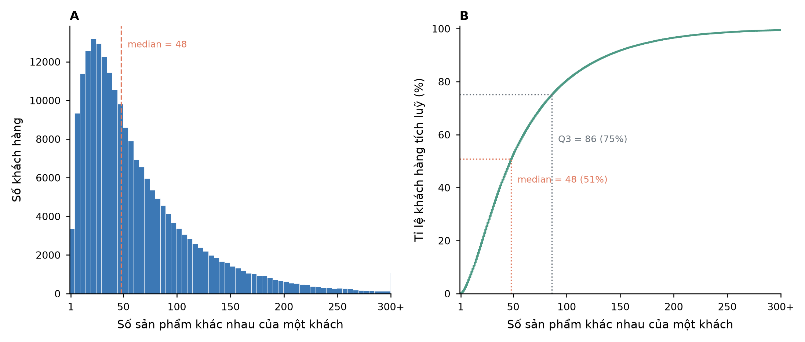

*Figure 11. Số sản phẩm khác nhau của mỗi khách (n = 206.209 khách). A: histogram, bin rộng 5, giá trị ≥ 300 gộp vào mốc 300+. B: ECDF với median và Q3.*

Nhận xét: 

- Biểu đồ A lệch hẳn sang bên phải, có khoảng 50% số lượng khách hàng có không quá 48 sản phẩm khác nhau trong đơn của họ. Tuy nhiên, vẫn có một nhóm khách hàng có đơn hàng cao, 25% khách có trên 86 sản phẩm khác nhau; và số sản phẩm khác nhua lớn nhất là 726. 

- Nếu tính theo nhóm số đơn từ 4-10 đến 51-100, thì median sản phẩm khác nhau tăng, từ 30 -> 162; nhưng median tỉ lệ sản phẩm khác nhau lại giảm. Những người có càng nhiều đơn, họ mua nhiều mặt hàng hơn, nhưng càng về sau tkhách bắt đầu mua lặp lại những món cũ thay vì thêm món mới vòa giỏ hàng.

---

## 12. Hành vi mua lại theo sản phẩm, aisle và department

Phân tích thói quen tái mua hàng của khách theo 3 cấp độ phân cấp sản phẩm: Sản phẩm -> Nhóm chi tiết -> Ngành hàng

Định nghĩa: `reordered = 1` trên các dòng thuộc đơn có `order_number >= 2`; đơn đầu tiên bị loại vì chưa có lịch sử mua. Tỉ lệ ở cấp nhóm là tổng `reordered` chia tổng số dòng hợp lệ (line-weighted).

| Chỉ số                                   | Giá trị       | Đơn vị / cách hiểu                                                                                    |
| ---------------------------------------- | ------------- | -----------------------------------------------------------------------------------------------------:|
| Tổng số dòng sản phẩm trong `prior`      | 32.434.489    | Tất cả dòng                                                                                           |
| Dòng thuộc đơn từ lần thứ 2 trở đi       | 30.356.421    | Dòng hợp lệ                                                                                           |
| Tỷ lệ mua lại gộp trên dòng hợp lệ       | 63,01%        | Tổng dòng `reordered = 1` / tổng dòng hợp lệ (Trung bình có trọng số theo lượt mua)                   |
| Tỷ lệ mua lại gộp trên toàn bộ dòng      | 58,97%        | Tổng dòng `reordered = 1` / tất cả dòng                                                               |
| Số sản phẩm được phân tích               | 19.389        | Sản phẩm có ≥ 100 dòng hợp lệ ()                                                                      |
| Trung vị tỷ lệ mua lại giữa các sản phẩm | 53,85%        | Tính tỷ lệ mua lại riêng của từng sản phẩm (trên 19,389 sản phẩm có >=100 lượt mua, rồi lấy trung vị) |
| Q1–Q3 tỷ lệ mua lại giữa các sản phẩm    | 41,28%–64,07% | Phân vị giữa các sản phẩm                                                                             |
| Min–Max tỷ lệ mua lại giữa các sản phẩm  | 0,53%–91,43%  | Khoảng giữa các sản phẩm                                                                              |

Nhận xét: 

- Tỷ lệ gộp (63,01%) là trung bình có trọng số theo số dòng, còn 53,85% là trung vị của tỷ lệ từng sản phẩm. Vì tỷ lệ gộp  > Trung vị chứng minh rằng những sản phẩm được mua với số lượng nhiều nhất trong siêu thị cũng chính là những sản phẩm có xu hướng được mua lại lặp lại nhiều nhất. 
- Tỷ lệ mua lại giữa các sản phẩm biến thiên rộng: 50% sản phẩm nằm trong khoảng 41,28%–64,07%, với min–max 0,53%–91,43%.
- Theo department, các nhóm thực phẩm tiêu dùng hằng ngày (dairy eggs, beverages, produce) có tỉ lệ mua lại cao nhất (~70%). Ngược lại, các nhóm ít khi phải mua định kỳ như personal care (34,53%), pantry (37,22%) có tỉ lệ thấp — mức chênh lệch giữa nhóm cao nhất và thấp nhất là khoảng 2 lần.
- Ở cấp aisle, milk dẫn đầu với 82,82%, cho thấy sữa là mặt hàng có tính lặp lại cao nhất (cũng như Organic Reduced Fat Milk và Organic Low Fat Milk nằm trong top sản phẩm).

Theo sản phẩm: các sản phẩm có tỉ lệ mua lại cao nhất (≥ 5.000 dòng hợp lệ) gồm Organic Reduced Fat Milk (90.00%, 33.709 dòng), Banana (89.97%, 443.031 dòng) và Organic Low Fat Milk (89.93%, 7.828 dòng). Trong nhóm 15 sản phẩm có số đơn cao nhất, tỉ lệ mua lại dao động từ 67.69% (Organic Blueberries) đến 89.97% (Banana).

Theo department: cao nhất là dairy eggs (71.39%), beverages (69.69%) và produce (69.26%), những thực phẩm tươi sống, sữa, đồ uống, sử dụng hằng ngày và có chu kỳ sử dụng ngắn; thấp nhất là personal care (34.53%), pantry (37.22%) và international (39.72%), những sản phẩm có chu kỳ sử dụng dài (vài tháng mới hết) or mang tính thử nghiệm ngẫu hứng.

Theo aisle (aisle có ≥ 10.000 dòng hợp lệ): cao nhất là milk (82.82%), water seltzer sparkling water (77.51%) và fresh fruits (76.34%).

Từ đây có thể rút ra các kết luận 

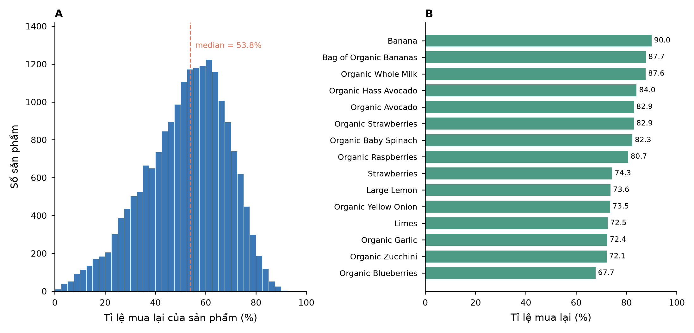

*Figure 12. A: phân phối tỉ lệ mua lại của 19.389 sản phẩm có ≥ 100 dòng hợp lệ. B: 15 sản phẩm có số đơn cao nhất, xếp theo tỉ lệ mua lại.*

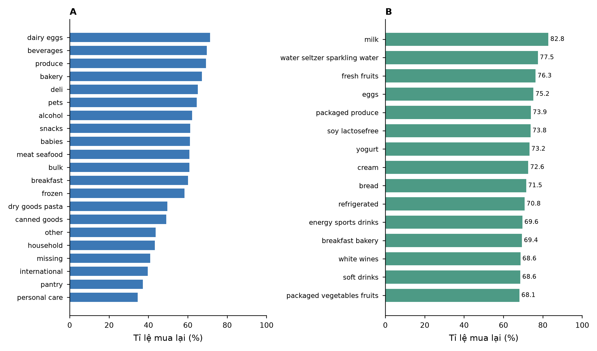

*Figure 13. A: tỉ lệ mua lại theo 21 department. B: 15 aisle có tỉ lệ mua lại cao nhất trong các aisle có ≥ 10.000 dòng hợp lệ. Tất cả tính trên 30.356.421 dòng thuộc đơn `order_number >= 2`.*

---

## 13. Tần suất mua và xác suất mua lại ở đơn kế tiếp

Mẫu phân tích: 131.209 khách hàng có đơn cuối thuộc tập `train` (đơn ngay sau `prior`, có đầy đủ danh sách sản phẩm để kiểm tra việc mua lại). Với mỗi khách hàng, các sản phẩm đã mua trong `prior` được gom thành các cặp duy nhất `(user_id, product_id)`, đếm số lần mua (`frequency`) và kiểm tra sản phẩm có xuất hiện trong đơn `train` hay không.

| Chỉ số                                                                                                                   | Giá trị    | Đơn vị / cách hiểu                                       |
|:------------------------------------------------------------------------------------------------------------------------ | ----------:|:-------------------------------------------------------- |
| Số khách hàng trong mẫu                                                                                                  | 131.209    | Khách hàng có đơn cuối thuộc `train`                     |
| Số dòng mua trong `prior` của mẫu                                                                                        | 20.641.991 | Tổng dòng order–product trong `prior` của 131.209 khách  |
| Số cặp duy nhất (khách, sản phẩm)                                                                                        | 8.474.661  | Cặp `(user_id, product_id)` phân biệt trong `prior`      |
| Tổng số dòng trong đơn `train`                                                                                           | 1.384.617  | Sản phẩm trong 131.209 đơn `train` (mean 10,55 item/đơn) |
| Số dòng mua lại trong đơn `train`                                                                                        | 828.824    | Sản phẩm trong `train` từng xuất hiện trong `prior`      |
| Tỉ lệ mua lại trong giỏ hàng `train`(Đơn ở train có sản phẩm đã xuất hiện ở trong prior)                                 | 59,86%     | 828.824 dòng mua lại / 1.384.617 dòng đơn `train`        |
| Trung bình sản phẩm mua lại trên mỗi đơn `train` (Trung bình sản phẩm mua lại trên mỗi khách hàng có trong bảng `train`) | 6,32       | 828.824 dòng mua lại / 131.209 đơn `train`               |
| Xác suất mua lại tính trên một cặp (khách, sản phẩm)                                                                     | 9,78%      | 828.824 / 8.474.661 cặp ứng viên                         |

| Số lần đã mua trong `prior` | Số cặp    | Tỉ lệ cặp (%) | Mua lại ở đơn kế tiếp (%) - |
|:--------------------------- | ---------:| -------------:| ---------------------------:|
| 1                           | 5.083.521 | 59,98         | 4,71                        |
| 2                           | 1.402.888 | 16,55         | 10,49                       |
| 3                           | 656.064   | 7,74          | 15,55                       |
| 4                           | 369.656   | 4,36          | 18,70                       |
| 5–9                         | 653.068   | 7,71          | 23,89                       |
| 10–19                       | 237.596   | 2,80          | 33,84                       |
| 20+                         | 71.868    | 0,85          | 48,43                       |

Giải thích bảng: 

- Số lần đã mua trong prior ->Số đơn hàng trong quá khứ mà khách hàng đã từng mua sản phẩm đó.

- Số cặp -> Số lượng cặp (khách, sản phẩm) duy nhất rơi vào nhóm tần suất đó (trên tổng số 8.474.661 cặp).

- Tỉ lệ cặp (%) -> Tỷ trọng của nhóm đó trong lịch sử (Số cặp nhóm đó / 8.474.661).

- Mua lại ở đơn kế tiếp (%) -> Xác suất thực tế: Trong 100 cặp thuộc nhóm này, có bao nhiêu cặp thực sự xuất hiện trong giỏ hàng ở đơn train kế tiếp.

Gần 60% món hàng trong lịch sử chỉ là "mua một lần". Trong khi đó, những sản phẩm được mua thường xuyên (>=5 lần) chỉ chiếm 11.36%, và mua >= 20 lần chiếm 0.85%. Điều này cho thấy, khách hàng thử nghiệm rất nhiều món mới (đồ lạ, khuyến mãi,...), nhưng danh sách các món họ thực sự yêu thích và mua định kỳ chỉ gói gọn trong một nhóm rất nhỏ.

Khi họ mua càng nhiều lần thì khả năng mua lại càng cao. Nhìn vào biểu đồ thấy "Tần suất mua trong quá khứ tăng từ 1 -> 20+ làm xác suất mua cũng tăng theo 10 lần"

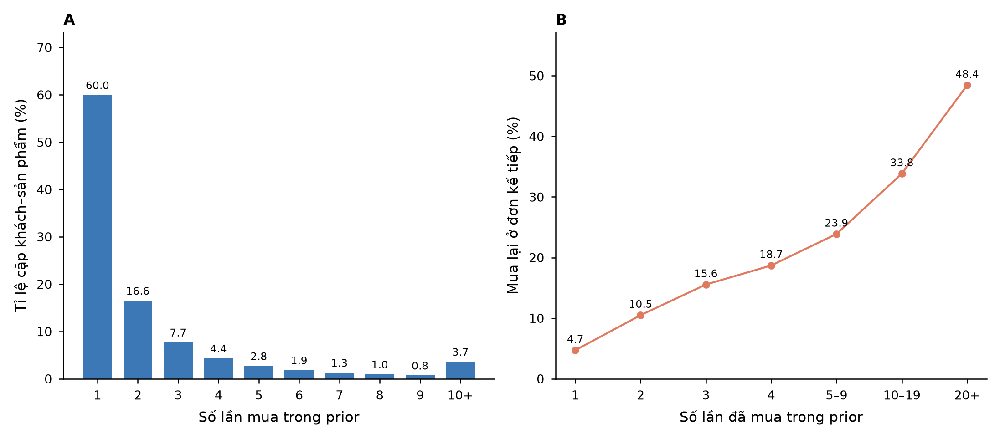

*Figure 14. A: phân phối số lần mua của 8.474.661 cặp (khách, sản phẩm). B: xác suất sản phẩm xuất hiện trong đơn `train` theo số lần đã mua trong `prior`. Mẫu: 131.209 khách có đơn `train`; đơn `train` là đơn ngay sau `prior`. (tức là trong cách cặp đã mua K lần ở biểu đồ A, tỉ lệ mua lại ở đơn tiếp theo (train) là bao nhiêu?*

Nhận xét: 

- Biểu đồ A lệch phải mạnh: 59,98% cặp (khách, sản phẩm) chỉ được mua đúng 1 lần, chỉ 11,36% cặp được mua từ 5 lần trở lên.
- Biểu đồ B cho thấy xác suất mua lại ở đơn kế tiếp tăng đều theo số lần đã mua: từ 4,71% (mua 1 lần) lên 48,43% (mua từ 20 lần) - tăng hơn 10 lần. Sản phẩm khách mua càng nhiều lần thì càng có khả năng xuất hiện trong đơn tiếp theo.
- Xác suất mua lại tính trên một cặp chỉ là 9,78%, nhưng 59,86% số dòng trong đơn `train` lại là sản phẩm đã từng mua. Nghĩa là mỗi khách có nhiều sản phẩm trong lịch sử, nhưng mỗi đơn chỉ chọn lại một phần nhỏ (trung bình 6,32 sản phẩm/đơn).
- Số lần đã mua trong `prior` là đặc trưng tiềm năng cho bài toán dự đoán mua lại.

---

## 14. Recency và xác suất mua lại

"Đã bao nhiêu lần đi chợ rồi vị khách này không myua lại món đồ này?" -> Số đơn hàng trôi qua mà món đồ đó vắng mặt trong đơn hàng của khách.

Recency được đo bằng số đơn giữa lần mua cuối trong `prior` và đơn `train`: 0 nghĩa là sản phẩm được mua ở đơn `prior` cuối cùng, 1 nghĩa là có một đơn ở giữa, v.v. Cách đo theo số đơn tránh giới hạn cap 30 ngày của `days_since_prior_order`.

| Chỉ số                    | Giá trị    |
| ------------------------- | ----------:|
| Median recency            | 4 đơn      |
| Mean recency              | 9,52 đơn   |
| Q1 / Q3                   | 1 / 12 đơn |
| Tỉ lệ cặp có recency 0    | 16,04%     |
| Tỉ lệ cặp có recency ≥ 10 | 30,75%     |

Tỷ lệ trong ô = Số cặp xuất hiện trong đơn train * 100 / Tổng số cặp thỏa đồng thời 2 điều kiện Recency và Tần suất  

| Recency (số đơn) | Số cặp    | Tỉ lệ cặp (%) | Mua lại (%) |
|:---------------- | ---------:| -------------:| -----------:|
| 0                | 1.358.988 | 16,04         | 27,92       |
| 1                | 968.287   | 11,43         | 16,20       |
| 2                | 804.176   | 9,49          | 11,07       |
| 3–4              | 1.139.840 | 13,45         | 7,58        |
| 5–9              | 1.597.150 | 18,85         | 4,49        |
| 10–19            | 1.359.405 | 16,04         | 2,37        |
| 20+              | 1.246.815 | 14,71         | 1,05        |

| Recency (số đơn) | Đã mua 1 lần (%) | Đã mua 2–4 lần (%) | Đã mua 5+ lần (%) |
| ---------------- | ----------------:| ------------------:| -----------------:|
| 0                | 13,53            | 30,87              | 49,22             |
| 1                | 8,48             | 19,81              | 34,60             |
| 2                | 6,74             | 14,34              | 26,18             |
| 3–4              | 4,80             | 10,06              | 18,70             |
| 5–9              | 2,99             | 6,19               | 10,99             |
| 10–19            | 1,67             | 3,33               | 5,55              |
| 20+              | 0,80             | 1,45               | 2,31              |

Cột (Tần suất mua lại trong quá khứ): Chia toàn bộ các cặp (khách, sản phẩm) thành 3 nhóm dựa trên số lần đã mua trong pior. 

Hàng (Recency) Khoảng cách từ lần cuối cùng trong prior đến đơn train 

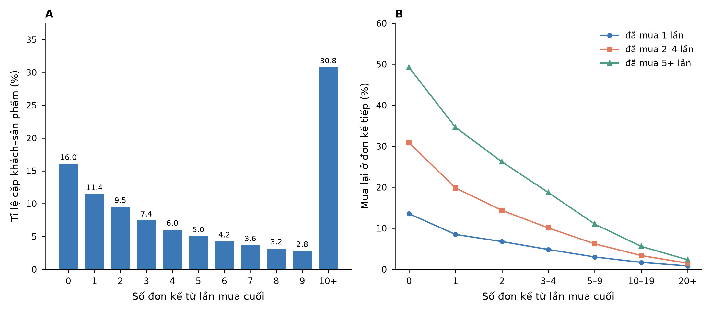

*Figure 15. A: phân phối recency của 8.474.661 cặp. B: xác suất mua lại theo recency, tách theo số lần đã mua trong `prior`. Recency 0 = mua ở đơn `prior` cuối cùng; đơn `train` là đơn kế tiếp.*

Nhận xét: 

- Xác suất mua lại giảm dần khi recency tăng: 27,92% nếu sản phẩm có trong đơn `prior` cuối cùng, giảm còn 16,20% (recency 1), 4,49% (recency 5–9) và chỉ 1,05% khi lần mua cuối cách đó từ 20 đơn trở lên.
- Ở mọi mức recency, nhóm đã mua 5+ lần luôn có xác suất cao hơn nhóm 2–4 lần và nhóm 1 lần (ví dụ ở recency 0: 49,22% so với 30,87% và 13,53%). Như vậy cả tần suất (mục 13) và recency đều ảnh hưởng đến khả năng mua lại.
- Hai thái cực chênh lệch rất lớn: mua 5+ lần và vừa mua ở đơn trước (49,22%) so với chỉ mua 1 lần và cách đây từ 20 đơn (0,80%).
- Phân phối recency khá trải rộng (median 4 đơn, mean 9,52 đơn); 30,75% cặp có recency ≥ 10, tức là nhiều sản phẩm trong lịch sử đã lâu không được mua lại.

---

## 15. Các sản phẩm xuất hiện cùng nhau

Phân tích trên 3.214.874 đơn `prior`, giới hạn ở 300 sản phẩm có số đơn cao nhất (44.850 cặp). Với cặp A, B:

- `support` = số đơn chứa cả A và B / tổng số đơn -> Đo độ phổ biến của các cặp sản phẩm trong toàn bộ hệ thống
- `confidence A→B` = P(B | A) -> Nếu khách đã chọn món A vào giỏ thì xác xuất họ sẽ nhặt thêm món B là bao nhiêu. Và xác suất này không có tính đối xứng, tức là P(B | A) >< P(A | B). Người chọn Bơ thì có tới 30% cơ hội mua Chuối, nhưng mua Chuối thì chỉ có 15% cơ hội mua thêm Bơ. 
- `lift` = support(A, B) / [support(A) × support(B)] = P(B | A)/(P(B)) -> Đo lường mức độ gắn kết thực sự giữa 2 sản phẩm (đã loại trừ độ phổ biến tự nhiên của từng món):
    • Lift = 1: A và B hoàn toàn độc lập (mua A không ảnh hưởng gì đến việc mua B).
    • Lift < 1: A và B triệt tiêu/thay thế nhau (đã mua A thì ít khi mua B, ví dụ sữa chua Vinamilk vs sữa chua TH True Milk).
    • Lift > 1: A và B tương hỗ mạnh (mua A kích thích mua B).

Có 4.677 cặp đạt support ≥ 0,05% số đơn.

**Top cặp theo số đơn cùng xuất hiện**

| Cặp sản phẩm (A + B)                          | Cùng đơn | Support (%) | Conf A→B (%) | Conf B→A (%) | Lift |
| --------------------------------------------- | --------:| -----------:| ------------:| ------------:| ----:|
| Bag of Organic Bananas + Organic Hass Avocado | 62.341   | 1,94        | 16,43        | 29,19        | 2,47 |
| Bag of Organic Bananas + Organic Strawberries | 61.628   | 1,92        | 16,24        | 23,28        | 1,97 |
| Banana + Organic Strawberries                 | 56.156   | 1,75        | 11,88        | 21,22        | 1,44 |
| Banana + Organic Avocado                      | 53.395   | 1,66        | 11,30        | 30,20        | 2,05 |
| Banana + Organic Baby Spinach                 | 51.395   | 1,60        | 10,88        | 21,24        | 1,45 |
| Bag of Organic Bananas + Organic Baby Spinach | 50.372   | 1,57        | 13,28        | 20,82        | 1,76 |
| Banana + Strawberries                         | 41.232   | 1,28        | 8,73         | 28,84        | 1,96 |
| Banana + Large Lemon                          | 40.880   | 1,27        | 8,65         | 26,78        | 1,82 |

**Top cặp theo lift** (support ≥ 0,05%; mỗi sản phẩm tối đa 1 cặp và mỗi aisle tối đa 3 cặp để tránh lặp biến thể)

| Cặp sản phẩm (A + B)                                                                                      | Cùng đơn | Support (%) | Conf A→B (%) | Conf B→A (%) | Lift  |
| --------------------------------------------------------------------------------------------------------- | --------:| -----------:| ------------:| ------------:| -----:|
| Icelandic Style Skyr Blueberry Non-fat Yogurt + Non Fat Raspberry Yogurt                                  | 7.224    | 0,22        | 37,51        | 44,11        | 73,64 |
| Total 2% Lowfat Greek Strained Yogurt With Blueberry + Total 2% Lowfat Greek Strained Yogurt with Peach   | 6.282    | 0,20        | 30,26        | 31,56        | 48,87 |
| Total 2% with Strawberry Lowfat Greek Strained Yogurt + Total 2% Greek Strained Yogurt with Cherry 5.3 oz | 5.401    | 0,17        | 18,07        | 29,93        | 32,19 |
| Peach Pear Flavored Sparkling Water + Sparkling Water Berry                                               | 3.453    | 0,11        | 16,26        | 19,83        | 30,03 |
| Organic Raw Kombucha Gingerade + Trilogy Kombucha Drink                                                   | 2.939    | 0,09        | 14,19        | 17,50        | 27,18 |
| Pineapple Chunks + Mango Chunks                                                                           | 3.467    | 0,11        | 13,90        | 19,59        | 25,24 |
| Organic Whole Strawberries + Frozen Organic Wild Blueberries                                              | 6.763    | 0,21        | 21,51        | 22,61        | 23,12 |
| Orange Bell Pepper + Yellow Bell Pepper                                                                   | 7.124    | 0,22        | 18,18        | 27,98        | 22,96 |

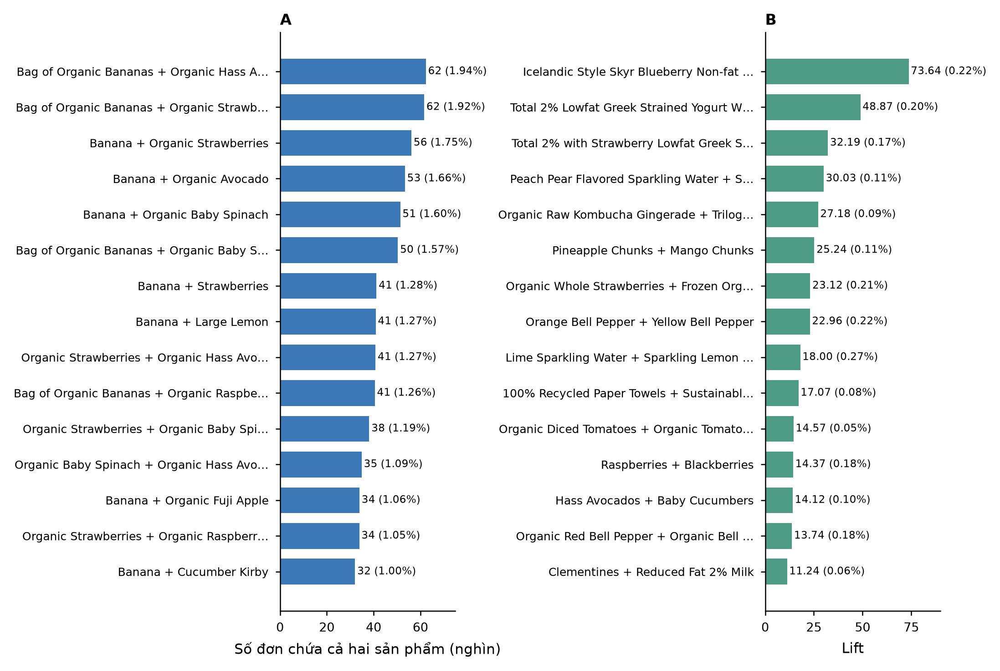

*Figure 16. A: 15 cặp có số đơn chứa cả hai cao nhất. B: 15 cặp có lift cao nhất sau khi lọc support ≥ 0,05% và giới hạn mỗi sản phẩm/aisle. Số trong ngoặc là support (%). Dữ liệu: 3.214.874 đơn `prior`, 300 sản phẩm phổ biến nhất.*

Nhận xét: 

- Các cặp có số đơn cùng xuất hiện cao nhất đều chứa chuối (Banana hoặc Bag of Organic Bananas) đi kèm một loại rau củ, trái cây phổ biến khác. Lift của các cặp này chỉ ở mức 1,44 – 2,47, tức là chúng xuất hiện cùng nhau chủ yếu do bản thân mỗi sản phẩm đều rất phổ biến.
- Confidence của các cặp này bất đối xứng: Conf B→A luôn cao hơn Conf A→B (ví dụ Organic Hass Avocado → Bag of Organic Bananas là 29,19%, chiều ngược lại chỉ 16,43%), vì chuối xuất hiện trong rất nhiều đơn.
- Ngược lại, các cặp có lift cao nhất (22,96 – 73,64) phần lớn là các biến thể của cùng một loại sản phẩm: sữa chua khác vị, nước có ga khác vị, kombucha, ớt chuông khác màu. Khách hàng thường mua nhiều hương vị của cùng một dòng sản phẩm trong một đơn.
- Tuy nhiên support của các cặp lift cao chỉ khoảng 0,09% – 0,22%, nhỏ hơn rất nhiều so với các cặp phổ biến (1,27% – 1,94%). Cần cân nhắc cả support và lift khi chọn luật kết hợp.

---

## 16. Độ phổ biến sản phẩm theo department

Độ phổ biến của một sản phẩm = số dòng order-product `prior` chứa sản phẩm (tổng 32.434.489 dòng). Chỉ tính 49.677 sản phẩm có ít nhất một dòng; department xếp theo median giảm dần.

| Department      | Số sản phẩm | Median dòng/sản phẩm | Q1 – Q3        | Max     | Dòng của 10% sản phẩm đầu (%) |
| --------------- | -----------:| --------------------:| --------------:| -------:| -----------------------------:|
| produce         | 1.684       | 329,0                | 56,0 – 2.328,8 | 472.565 | 81,23                         |
| dairy eggs      | 3.448       | 206,0                | 44,0 – 932,2   | 137.905 | 72,82                         |
| bulk            | 38          | 188,0                | 70,8 – 776,0   | 10.150  | 63,44                         |
| breakfast       | 1.114       | 136,5                | 34,0 – 560,0   | 26.741  | 62,62                         |
| bakery          | 1.516       | 132,5                | 35,0 – 583,2   | 60.816  | 67,27                         |
| deli            | 1.322       | 115,0                | 32,0 – 476,5   | 71.314  | 73,11                         |
| frozen          | 4.007       | 107,0                | 32,0 – 386,0   | 55.946  | 68,56                         |
| meat seafood    | 907         | 93,0                 | 25,0 – 411,5   | 50.281  | 76,30                         |
| dry goods pasta | 1.858       | 82,0                 | 21,0 – 293,0   | 19.998  | 70,38                         |
| beverages       | 4.363       | 78,0                 | 21,0 – 330,0   | 75.886  | 75,21                         |
| canned goods    | 2.092       | 78,0                 | 20,0 – 288,5   | 38.001  | 74,08                         |
| snacks          | 6.263       | 75,0                 | 22,0 – 303,0   | 24.950  | 69,81                         |
| babies          | 1.081       | 75,0                 | 20,0 – 282,0   | 8.793   | 65,37                         |
| pantry          | 5.370       | 50,0                 | 15,0 – 208,0   | 50.255  | 72,86                         |
| international   | 1.139       | 50,0                 | 15,0 – 168,5   | 10.345  | 66,46                         |
| pets            | 972         | 42,0                 | 16,0 – 118,2   | 1.825   | 48,57                         |
| household       | 3.083       | 41,0                 | 13,0 – 165,0   | 27.864  | 69,64                         |
| alcohol         | 1.054       | 28,0                 | 11,0 – 85,0    | 8.246   | 71,43                         |
| other           | 548         | 23,0                 | 9,0 – 53,2     | 3.976   | 58,88                         |
| personal care   | 6.563       | 22,0                 | 9,0 – 57,0     | 5.941   | 59,39                         |
| missing         | 1.255       | 12,0                 | 6,0 – 28,0     | 8.366   | 73,23                         |

"Dòng 10% sản phẩm đầu (%)" đo Top 10% sản phẩm bán chạy nhất trong ngành hàng đó chiếm bao nhiêu phần trăm tổng số lượt mua của cả ngành hàng. -> Thước đo mức độ tập trung (hiệu ứng Patero)

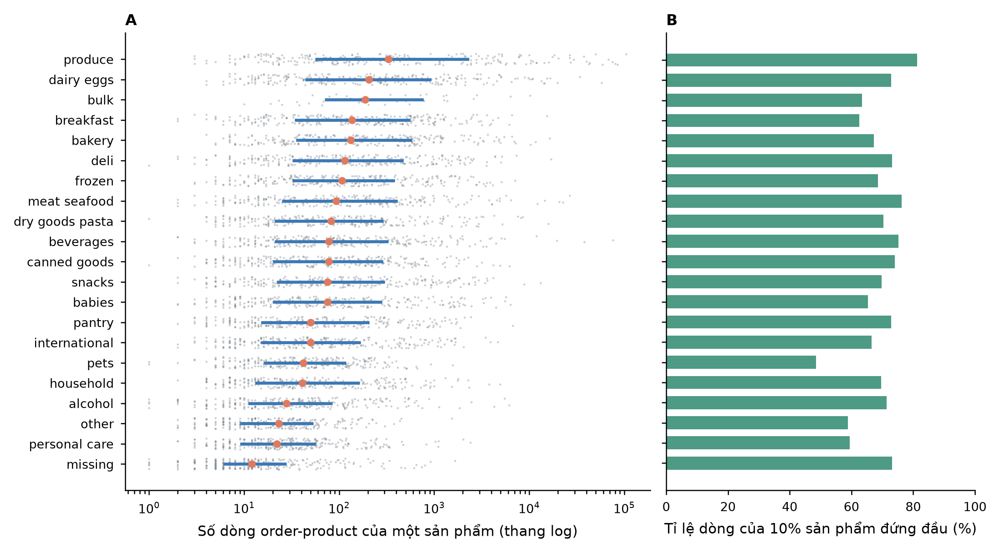

*Figure 18. A: số dòng order-product của từng sản phẩm theo department (thang log); chấm xám là 250 sản phẩm lấy ngẫu nhiên (seed 42) mỗi department (toàn bộ nếu ít hơn), đoạn xanh là Q1–Q3 và chấm cam là median tính trên toàn bộ sản phẩm. B: tỉ lệ số dòng của department thuộc 10% sản phẩm có số dòng cao nhất (làm tròn lên).*

Nhận xét: 

- Produce có median số dòng mỗi sản phẩm cao nhất (329), tiếp theo là dairy eggs (206); thấp nhất là personal care (22) và missing (12).
- Personal care là department có nhiều sản phẩm nhất trong catalog (6.563) nhưng median thấp gần nhất. Nhóm này có rất nhiều sản phẩm nhưng mỗi sản phẩm lại ít được mua.
- Ở mọi department, khoảng Q1 – Q3 đều rộng và giá trị max cách xa median nhiều lần (ví dụ produce: median 329, max 472.565 — là Banana), cho thấy hiệu ứng long-tail xuất hiện cả bên trong từng department.
- Biểu đồ B: 10% sản phẩm đầu chiếm từ 48,57% (pets) đến 81,23% (produce) số dòng của department. Hơn 1500 món rau củ khác cộng lại chỉ vhieems chưa đầy 19%. Trừ pets, các department đều có 10% sản phẩm đầu chiếm hơn một nửa số dòng. Tức là thói qun mua đồ cho thú cưng rất đa dạng, không có nhóm sản phẩm nào áp đảo toàn bộ ngành hàng như trường hợp chuối trong quầy hoa quả.

---

## 17. Sản phẩm được thêm vào giỏ đầu tiên

Vị trí đầu tiên là dòng có `~~add_to_cart_order~~ = 1`: 3.214.874 dòng (một dòng mỗi đơn `prior`) trên tổng 32.434.489 dòng.

**Top 15 sản phẩm theo số lần ở vị trí đầu tiên**

| Sản phẩm                   | Số lần ở vị trí 1 | Tổng dòng | Tỉ lệ ở vị trí 1 (%) |
| -------------------------- | -----------------:| ---------:| --------------------:|
| Banana                     | 110.916           | 472.565   | 23,47                |
| Bag of Organic Bananas     | 78.988            | 379.450   | 20,82                |
| Organic Whole Milk         | 30.927            | 137.905   | 22,43                |
| Organic Strawberries       | 27.975            | 264.683   | 10,57                |
| Organic Hass Avocado       | 24.116            | 213.584   | 11,29                |
| Organic Baby Spinach       | 23.543            | 241.921   | 9,73                 |
| Organic Avocado            | 22.398            | 176.815   | 12,67                |
| Spring Water               | 16.822            | 56.087    | 29,99                |
| Strawberries               | 16.366            | 142.951   | 11,45                |
| Organic Raspberries        | 14.393            | 137.057   | 10,50                |
| Sparkling Water Grapefruit | 13.733            | 75.886    | 18,10                |
| Organic Half & Half        | 12.676            | 76.360    | 16,60                |
| Large Lemon                | 12.316            | 152.657   | 8,07                 |
| Soda                       | 11.770            | 35.791    | 32,89                |
| Organic Reduced Fat Milk   | 9.885             | 35.663    | 27,72                |

**Top 15 sản phẩm theo tỉ lệ ở vị trí đầu tiên** (sản phẩm có ≥ 5.000 dòng)

| Sản phẩm                        | Số lần ở vị trí 1 | Tổng dòng | Tỉ lệ ở vị trí 1 (%) |
| ------------------------------- | -----------------:| ---------:| --------------------:|
| Organic Low Fat Milk            | 3.418             | 8.438     | 40,51                |
| Drinking Water                  | 2.176             | 5.403     | 40,27                |
| Vodka                           | 1.945             | 5.475     | 35,53                |
| Mineral Water                   | 2.103             | 5.936     | 35,43                |
| Smartwater                      | 3.983             | 11.504    | 34,62                |
| Soda                            | 11.770            | 35.791    | 32,89                |
| Sparkling Mineral Water         | 5.828             | 18.161    | 32,09                |
| Organic  Whole Milk             | 3.080             | 9.842     | 31,29                |
| Sparkling Water                 | 3.841             | 12.321    | 31,17                |
| 0% Greek Strained Yogurt        | 4.064             | 13.238    | 30,70                |
| Extra Fancy Unsalted Mixed Nuts | 2.961             | 9.709     | 30,50                |
| Zero Calorie Cola               | 2.592             | 8.558     | 30,29                |
| Spring Water                    | 16.822            | 56.087    | 29,99                |
| Reduced Fat 2% Milk             | 5.180             | 17.320    | 29,91                |
| Sweet Kale Salad Mix            | 3.339             | 11.362    | 29,39                |

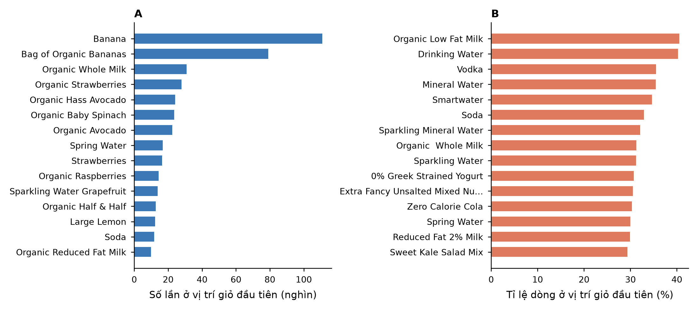

*Figure 19. A: 15 sản phẩm có số lần ở vị trí giỏ đầu tiên cao nhất. B: 15 sản phẩm có tỉ lệ dòng ở vị trí giỏ đầu tiên cao nhất trong nhóm ≥ 5.000 dòng. Dữ liệu: 32.434.489 dòng `prior`.*

Nhận xét: 

- Theo số lần, Banana dẫn đầu với 110.916 lần được thêm vào giỏ đầu tiên (23,47% số dòng của nó), theo sau là Bag of Organic Bananas và Organic Whole Milk. Danh sách này khá giống với top sản phẩm phổ biến ở mục 8, do sản phẩm càng phổ biến thì số lần ở vị trí đầu càng nhiều.
- Theo tỉ lệ, đứng đầu là các loại đồ uống (nước uống, nước khoáng, soda, vodka) và sữa — Organic Low Fat Milk và Drinking Water có hơn 40% số lần mua được thêm vào giỏ đầu tiên.
- Một số sản phẩm phổ biến nhưng ít khi được thêm đầu tiên, như Large Lemon (8,07%) hay Organic Baby Spinach (9,73%). Các sản phẩm này thường được thêm vào sau.
- Dữ liệu thứ tự vào giỏ cho thấy sự phân hóa rõ giữa (1) Mặt hàng mục đích/nhu yếu phẩm lên kế hoạch trước (sữa, nước giải khát) - thường kích hoạt giỏ hàng; và (2) Mặt hàng tươi sống bổ sung (chanh, rau gia vị, trái cây phụ) - thường được nhặt ở các bước sau.

## 18. Kích thước giỏ theo ngày và giờ đặt hàng

Kích thước giỏ = số dòng order-product trong đơn; 3.214.874 đơn `prior`, không có đơn thiếu item.

**Theo ngày trong tuần** (mã `order_dow` 0–6)

| order_dow | Số đơn  | Mean  | Median | Q1 – Q3 |
| --------- | -------:| -----:| ------:| -------:|
| 0         | 557.772 | 11,13 | 9      | 5 – 15  |
| 1         | 556.705 | 10,18 | 8      | 5 – 14  |
| 2         | 441.955 | 9,54  | 8      | 4 – 13  |
| 3         | 412.400 | 9,32  | 8      | 4 – 12  |
| 4         | 401.212 | 9,44  | 8      | 4 – 13  |
| 5         | 425.982 | 9,88  | 8      | 4 – 13  |
| 6         | 418.848 | 10,74 | 9      | 5 – 15  |

**Theo giờ trong ngày** (`order_hour_of_day`)

| Giờ | Số đơn  | Mean  | Median | Q1 – Q3 |
| --- | -------:| -----:| ------:| -------:|
| 0   | 21.372  | 10,24 | 8      | 5 – 14  |
| 1   | 11.596  | 9,98  | 8      | 4 – 13  |
| 2   | 7.070   | 9,82  | 8      | 4 – 13  |
| 3   | 5.120   | 10,02 | 8      | 4 – 13  |
| 4   | 5.175   | 10,30 | 8      | 4 – 14  |
| 5   | 8.972   | 9,82  | 8      | 4 – 13  |
| 6   | 28.792  | 10,10 | 8      | 4 – 14  |
| 7   | 86.656  | 10,29 | 8      | 5 – 14  |
| 8   | 168.321 | 10,22 | 8      | 5 – 14  |
| 9   | 243.496 | 10,09 | 8      | 4 – 14  |
| 10  | 271.885 | 10,17 | 8      | 5 – 14  |
| 11  | 268.006 | 10,22 | 8      | 5 – 14  |
| 12  | 256.206 | 10,23 | 8      | 5 – 14  |
| 13  | 261.174 | 10,20 | 8      | 5 – 14  |
| 14  | 265.556 | 10,14 | 8      | 5 – 14  |
| 15  | 266.132 | 10,01 | 8      | 5 – 13  |
| 16  | 255.949 | 9,91  | 8      | 5 – 13  |
| 17  | 214.080 | 9,76  | 8      | 5 – 13  |
| 18  | 170.998 | 9,58  | 8      | 5 – 13  |
| 19  | 131.620 | 9,57  | 8      | 5 – 13  |
| 20  | 98.109  | 9,96  | 8      | 5 – 13  |
| 21  | 73.436  | 10,84 | 9      | 5 – 15  |
| 22  | 57.540  | 11,03 | 9      | 5 – 15  |
| 23  | 37.613  | 10,70 | 9      | 5 – 14  |

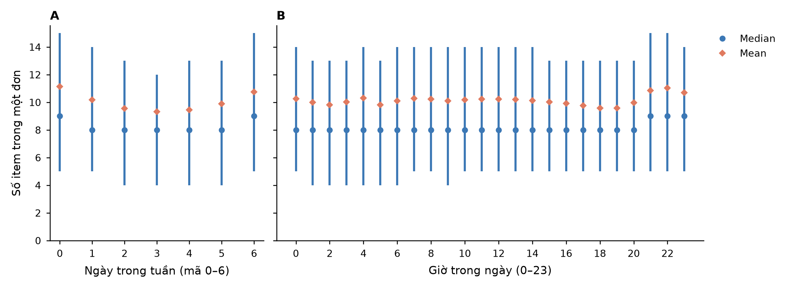

*Figure 20. Kích thước giỏ (số item/đơn) theo ngày trong tuần (A) và giờ trong ngày (B). Chấm xanh: median; đoạn: Q1–Q3; thoi cam: mean. n = 3.214.874 đơn `prior`.*

Nhận xét: 

- Theo ngày, ngày 0 có giỏ lớn nhất (mean 11,13, median 9), tiếp theo là ngày 6 (mean 10,74, median 9). Các ngày 2–4 có giỏ nhỏ nhất (mean 9,32 – 9,54, median 8).
- Theo giờ, median gần như cố định ở 8 item trong suốt cả ngày. Khung 21–23 giờ có giỏ lớn hơn một chút (mean 10,70 – 11,03, median 9), còn khung 17–19 giờ có giỏ nhỏ nhất (mean 9,57 – 9,76).
- Nhìn chung, mức chênh lệch kích thước giỏ theo thời điểm khá nhỏ (khoảng 1–2 item); thời điểm đặt hàng ảnh hưởng đến số lượng đơn (mục 4) nhiều hơn là đến số item trong mỗi đơn.
- Các khung 0–5 giờ có rất ít đơn (5.120 – 21.372 đơn), nên số liệu ở các khung này kém ổn định hơn.

---

## 19. Hồ sơ hành vi theo khách hàng

n = 206.209 khách (không khách nào thiếu giá trị), tính trên đơn `prior`. Tỉ lệ mua lại của khách = số dòng `reordered = 1` / số dòng của các đơn có `order_number ≥ 2`; giỏ trung bình = tổng item / số đơn `prior`; số ngày giữa hai đơn là mean của `days_since_prior_order` (bỏ NaN của đơn đầu).

| Chỉ số                          | Median | Q1 – Q3       | Mean  | Min  | Max    |
| ------------------------------- | ------:| -------------:| -----:| ----:| ------:|
| Số đơn `prior`                  | 9      | 5 – 19        | 16    | 3    | 99     |
| Số sản phẩm khác nhau           | 48     | 25 – 86       | 65    | 1    | 726    |
| Số item trung bình mỗi đơn      | 8,93   | 5,74 – 13,00  | 9,95  | 1,00 | 70,25  |
| Tỉ lệ mua lại (%)               | 50,00  | 33,33 – 65,52 | 48,98 | 0,00 | 100,00 |
| Số ngày trung bình giữa hai đơn | 14,50  | 9,42 – 20,29  | 15,21 | 0,00 | 30,00  |

Tương quan Spearman giữa số đơn `prior` và số sản phẩm khác nhau: ρ = 0,6736 (n = 206.209 khách).

**Số sản phẩm khác nhau theo nhóm số đơn `prior`**

| Số đơn `prior` | Số khách | Median sản phẩm khác nhau | Mean   |
| -------------- | --------:| -------------------------:| ------:|
| 4-5            | 35.755   | 28                        | 30,96  |
| 6-8            | 35.740   | 39                        | 42,58  |
| 9-12           | 30.035   | 53                        | 56,57  |
| 13-20          | 32.883   | 71                        | 75,23  |
| 21-35          | 26.118   | 98                        | 102,99 |
| 36-60          | 15.427   | 132                       | 138,37 |
| 61-100         | 6.265    | 175                       | 181,14 |

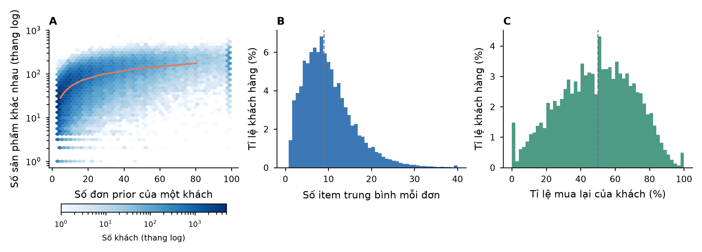

*Figure 21. A: mật độ khách theo số đơn `prior` và số sản phẩm khác nhau (thang log, hexbin, màu = số khách thang log); đường cam là median theo nhóm số đơn. B: phân phối số item trung bình mỗi đơn, giá trị ≥ 40 gộp vào cột cuối; đường nét đứt là median. C: phân phối tỉ lệ mua lại của khách. n = 206.209 khách.*

Nhận xét: 

- Một khách điển hình (median) có 9 đơn `prior`, mua 48 sản phẩm khác nhau, khoảng 8,93 item mỗi đơn, mua lại 50% và đặt đơn cách nhau khoảng 14,5 ngày.
- Biểu đồ A: số sản phẩm khác nhau tăng theo số đơn (Spearman ρ = 0,6736), nhưng tốc độ tăng chậm dần. Từ nhóm 4-5 đơn đến nhóm 61-100 đơn, số đơn tăng khoảng 15–20 lần nhưng median sản phẩm khác nhau chỉ tăng khoảng 6 lần (28 → 175). Khách càng mua nhiều thì càng lặp lại các sản phẩm quen thuộc (khớp với mục 11).
- Biểu đồ B lệch phải, tương tự phân phối kích thước giỏ ở mục 6: 50% khách có trung bình 5,74 – 13,00 item mỗi đơn (Q1 – Q3), và 56,15% khách nằm trong khoảng 5 – 13 item.
- Biểu đồ C có dạng gần đối xứng quanh 50%, nhưng có hai cột nhô lên ở 0% (1,48% khách) và 100% (0,47% khách) - là những khách không bao giờ mua lại hoặc luôn mua lại sản phẩm cũ.

---

## 20. Nhóm hành vi khách hàng (phân vị tần suất và PCA)

Khách hàng Instacart có thể được phân thành những nhóm hành vi nào, và không gian hành vi của họ có tạo thành các cụm tách biệt không?

Hành vi của người dùng được định hình bởi 4 câu hỏi cốt lõi tương ứng với 4 đặc trưng:
1. *Bao lâu khách hàng đi chợ một lần?* — `mean_gap` (số ngày trung bình giữa hai đơn, đo nhịp độ).
2. *Mỗi lần đi chợ mua nhiều hay ít đồ?* — `mean_basket` (kích thước giỏ TB, đại diện quy mô tiêu dùng).
3. *Khách thích khám phá nhiều món lạ hay chỉ quanh quẩn vài món?* — `distinct_products` (số sản phẩm khác nhau).
4. *Khách có thói quen mua lại đồ cũ hay đổi món mới?* — `reorder_rate` (tỉ lệ mua lại, đo độ trung thành).

Biến đổi: `log1p` cho `mean_gap`, `mean_basket`, `distinct_products`, sau đó z-score cả bốn đặc trưng (n = 206.209 khách). Nhóm = tertile của `mean_gap`; không dùng clustering. PCA tính bằng SVD trên toàn bộ khách; scatter vẽ 6.000 khách lấy ngẫu nhiên (seed 42).

| Nhóm (tertile mean_gap) | Số khách | Khoảng mean_gap (ngày) | Median số đơn | Median mean_gap | Median giỏ TB | Median sản phẩm khác nhau | Median tỉ lệ mua lại (%) |
| ----------------------- | --------:| ----------------------:| -------------:| ---------------:| -------------:| -------------------------:| ------------------------:|
| Gap ngắn                | 68.746   | 0,00 – 11,07           | 22            | 7,74            | 9,00          | 73                        | 61,54                    |
| Gap vừa                 | 68.874   | 11,07 – 18,20          | 11            | 14,50           | 9,00          | 52                        | 50,00                    |
| Gap dài                 | 68.589   | 18,21 – 30,00          | 6             | 22,71           | 8,64          | 33                        | 39,37                    |

**Tương quan Spearman giữa các đặc trưng**

|                   | mean_gap | mean_basket | distinct_products | reorder_rate |
| ----------------- | --------:| -----------:| -----------------:| ------------:|
| mean_gap          | 1,00     | -0,04       | -0,38             | -0,37        |
| mean_basket       | -0,04    | 1,00        | 0,68              | 0,08         |
| distinct_products | -0,38    | 0,68        | 1,00              | 0,22         |
| reorder_rate      | -0,37    | 0,08        | 0,22              | 1,00         |

PCA: phương sai giải thích PC1–PC4 = 47,88%, 30,39%, 16,64%, 5,09%.

| Đặc trưng         | Tải trọng PC1 | Tải trọng PC2 |
| ----------------- | -------------:| -------------:|
| mean_gap          | -0,400        | 0,567         |
| mean_basket       | 0,558         | 0,491         |
| distinct_products | 0,657         | 0,224         |
| reorder_rate      | 0,313         | -0,622        |

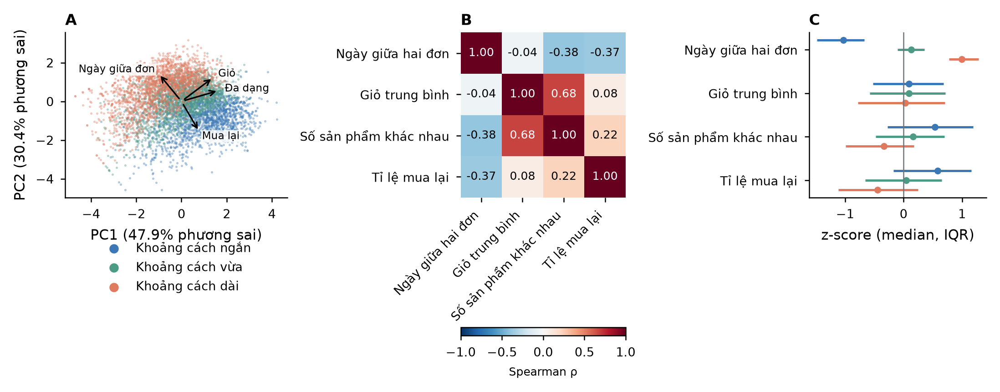

*Figure 22. A: PCA 2D của bốn đặc trưng đã chuẩn hoá, màu theo tertile `mean_gap` (xanh dương: khoảng cách ngắn, xanh lá: vừa, cam: dài); mũi tên là tải trọng PC1–PC2 nhân hệ số 2,6. B: tương quan Spearman ρ giữa bốn đặc trưng (chưa biến đổi). C: median và Q1–Q3 của z-score từng đặc trưng theo nhóm (màu như A). n = 206.209 khách.*

Nhận xét: 

- Nhóm gap ngắn (mua thường xuyên) có nhiều đơn hơn (median 22 đơn so với 6 đơn ở nhóm gap dài), đa dạng sản phẩm hơn (73 so với 33) và tỉ lệ mua lại cao hơn (61,54% so với 39,37%).
- Kích thước giỏ trung bình gần như không khác giữa ba nhóm (8,64 – 9,00), và tương quan giữa mean_gap và mean_basket gần bằng 0 (−0,04). Như vậy, tần suất mua không ảnh hưởng đến số item mỗi đơn.
- Biểu đồ B: mean_basket và distinct_products tương quan thuận khá mạnh (0,68); mean_gap tương quan nghịch với distinct_products (−0,38) và reorder_rate (−0,37).
- PC1 và PC2 giải thích 78,27% phương sai. PC1 chủ yếu gắn với mean_basket và distinct_products (quy mô mua sắm), còn PC2 đối lập mean_gap (+0,567) và reorder_rate (−0,622) (mức độ gắn bó).
- Trong biểu đồ A, ba nhóm tách nhau theo hướng của mũi tên “Ngày giữa đơn” và “Mua lại”, nhưng vẫn chồng lấn đáng kể — dữ liệu không tạo thành các cụm tách biệt rõ ràng.

---

## 21. Tỉ lệ mua lại theo order_number và khoảng cách đơn trước

Tỉ lệ `reordered = 1`:

- Tất cả dòng `prior`: 58,97% (19.126.536 / 32.434.489 dòng).
- Dòng thuộc đơn `order_number ≥ 2`: 63,01% (19.126.536 / 30.356.421 dòng). Toàn bộ dòng của đơn đầu tiên có `reordered = 0`.

Tỉ lệ gộp = tổng dòng `reordered = 1` / tổng dòng trong nhóm; Q1 – Q3 là phân vị của tỉ lệ từng đơn trong nhóm.

**Theo `order_number`** (đơn `order_number ≥ 2`; trích một số mốc, đầy đủ trong `docs/customer_summary.json`)

| order_number | Số đơn  | Tỉ lệ gộp (%) | Q1 – Q3 theo đơn (%) |
| ------------ | -------:| -------------:| --------------------:|
| 2            | 206.209 | 27,24         | 5,9 – 44,4           |
| 3            | 206.209 | 38,63         | 17,4 – 60,0          |
| 4            | 182.223 | 45,83         | 25,0 – 66,7          |
| 5            | 162.633 | 50,74         | 30,4 – 75,0          |
| 10           | 101.696 | 63,66         | 46,2 – 88,9          |
| 20           | 50.731  | 73,75         | 60,0 – 100,0         |
| 30           | 29.183  | 77,81         | 66,7 – 100,0         |
| 50           | 10.910  | 81,90         | 71,4 – 100,0         |
| 75           | 3.453   | 83,79         | 75,0 – 100,0         |
| 99           | 1.374   | 84,26         | 75,0 – 100,0         |

**Theo số ngày kể từ đơn trước** (`days_since_prior_order`, đơn `order_number ≥ 2`, nhóm 30 là giá trị chặn trên)

| Số ngày | Số đơn  | Tỉ lệ gộp (%) | Q1 – Q3 theo đơn (%) |
| ------- | -------:| -------------:| --------------------:|
| 0       | 64.436  | 73,88         | 45,5 – 100,0         |
| 1       | 141.011 | 61,76         | 33,3 – 100,0         |
| 2       | 187.723 | 64,54         | 42,9 – 100,0         |
| 3       | 210.665 | 66,86         | 50,0 – 100,0         |
| 7       | 306.181 | 69,37         | 50,0 – 96,3          |
| 10      | 90.198  | 64,39         | 44,4 – 92,3          |
| 14      | 93.064  | 62,83         | 42,9 – 90,0          |
| 21      | 41.262  | 58,41         | 37,5 – 85,7          |
| 28      | 23.833  | 55,05         | 33,3 – 83,3          |
| 29      | 16.976  | 54,31         | 33,3 – 83,3          |
| 30      | 306.137 | 45,56         | 20,0 – 75,0          |

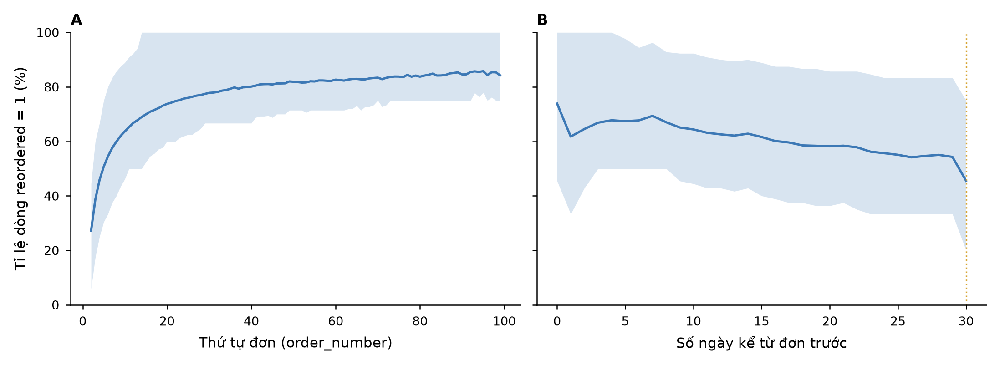

*Figure 23. Tỉ lệ dòng `reordered = 1` theo `order_number` (A) và theo số ngày kể từ đơn trước (B). Đường: tỉ lệ gộp; vùng tô: Q1–Q3 của tỉ lệ từng đơn; đường chấm vàng ở 30 ngày đánh dấu giá trị chặn trên. n = 30.356.421 dòng thuộc 3.008.665 đơn `order_number ≥ 2`.*

Nhận xét: 

- Biểu đồ A: tỉ lệ mua lại tăng nhanh ở những đơn đầu (27,24% ở đơn thứ 2 → 50,74% ở đơn thứ 5 → 63,66% ở đơn thứ 10), sau đó tăng chậm dần và đạt khoảng 84% từ đơn thứ 75 trở đi.
- Điều này hợp lý vì khách càng có nhiều đơn thì lịch sử càng dài, nên càng nhiều sản phẩm trong giỏ là sản phẩm đã từng mua.
- Biểu đồ B: tỉ lệ mua lại cao nhất khi hai đơn đặt trong cùng một ngày (73,88%), có một đỉnh nhỏ ở mốc 7 ngày (69,37%), sau đó giảm dần và thấp nhất ở mốc 30 ngày (45,56%). Khách quay lại càng lâu thì giỏ hàng càng ít sản phẩm cũ.
- Khoảng Q1 – Q3 theo đơn rất rộng (nhiều nhóm chạm tới 100%), cho thấy tỉ lệ mua lại giữa các đơn trong cùng một nhóm vẫn chênh lệch nhiều.

---

## 22. Cặp department cùng xuất hiện trong giỏ

Dữ liệu: 3.214.874 đơn `prior`, 21 department (210 cặp). Với department A, B: `support` = số đơn chứa cả hai / tổng số đơn; `lift` = support(A, B) / [support(A) × support(B)]. Lift của các cặp nằm trong khoảng 0,11 – 3,10; 185 / 210 cặp có lift > 1.

Tỉ lệ đơn chứa department (%): produce 74,94, dairy eggs 67,73, beverages 45,33, snacks 43,28, frozen 36,74, pantry 34,77, bakery 27,42, deli 23,96, canned goods 21,19, dry goods pasta 18,60, meat seafood 17,88, breakfast 16,34, household 14,64, personal care 9,91, international 6,89, babies 5,53, alcohol 2,63, missing 1,85, pets 1,84, other 1,09, bulk 1,05.

**10 cặp có support cao nhất**

| Cặp department         | Cùng đơn  | Support (%) | Lift |
| ---------------------- | ---------:| -----------:| ----:|
| produce + dairy eggs   | 1.769.735 | 55,05       | 1,08 |
| produce + snacks       | 1.084.254 | 33,73       | 1,04 |
| produce + beverages    | 1.072.365 | 33,36       | 0,98 |
| dairy eggs + snacks    | 1.036.951 | 32,25       | 1,10 |
| dairy eggs + beverages | 1.031.132 | 32,07       | 1,04 |
| produce + frozen       | 958.413   | 29,81       | 1,08 |
| produce + pantry       | 922.477   | 28,69       | 1,10 |
| dairy eggs + frozen    | 911.030   | 28,34       | 1,14 |
| dairy eggs + pantry    | 865.642   | 26,93       | 1,14 |
| beverages + snacks     | 736.539   | 22,91       | 1,17 |

**10 cặp có lift cao nhất**

| Cặp department                  | Cùng đơn | Support (%) | Lift |
| ------------------------------- | --------:| -----------:| ----:|
| alcohol + other                 | 2.863    | 0,09        | 3,10 |
| alcohol + pets                  | 3.941    | 0,12        | 2,52 |
| household + pets                | 21.809   | 0,68        | 2,51 |
| household + personal care       | 105.577  | 3,28        | 2,26 |
| personal care + pets            | 13.129   | 0,41        | 2,24 |
| personal care + other           | 7.323    | 0,23        | 2,11 |
| canned goods + international    | 90.221   | 2,81        | 1,92 |
| missing + other                 | 1.230    | 0,04        | 1,90 |
| canned goods + dry goods pasta  | 233.646  | 7,27        | 1,84 |
| dry goods pasta + international | 73.878   | 2,30        | 1,79 |

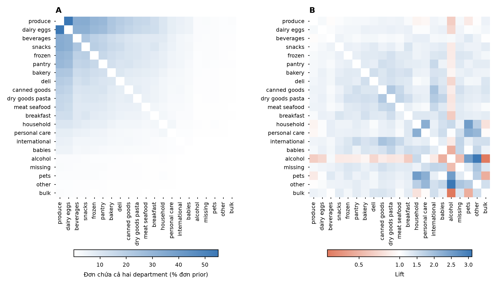

*Figure 24. A: support (% đơn `prior` chứa cả hai department). B: lift (thang chia đôi tại 1; đỏ cam < 1, xanh dương > 1). Department xếp theo tỉ lệ đơn chứa department giảm dần; đường chéo để trống. n = 3.214.874 đơn.*

Nhận xét: 

- Produce + dairy eggs là cặp phổ biến nhất, xuất hiện cùng nhau trong hơn một nửa (55,05%) số đơn.
- Tuy nhiên, lift của các cặp có support cao chỉ dao động quanh 1 (0,98 – 1,17), tức là chúng cùng xuất hiện chủ yếu vì mỗi department đều phổ biến; produce + beverages thậm chí có lift < 1 (0,98).
- Các cặp có lift cao nhất lại là các department nhỏ, ít liên quan đến thực phẩm tươi: alcohol + other (3,10), household + pets (2,51), household + personal care (2,26). Trong đó household + personal care có support đáng kể (3,28%) — khách thường mua đồ gia dụng và đồ cá nhân cùng nhau.
- Canned goods, dry goods pasta và international tạo thành một nhóm có lift cao với nhau (1,79 – 1,92), có thể là nhóm nguyên liệu nấu ăn khô.
- 185/210 cặp có lift > 1; phần lớn các department có xu hướng xuất hiện cùng nhau, một phần do giỏ hàng lớn thường chứa nhiều department hơn.

---

## 23. Support và lift của cặp sản phẩm

Dữ liệu: 3.214.874 đơn `prior`, 300 sản phẩm phổ biến nhất (44.850 cặp, định nghĩa như mục 15). Scatter dùng 4.677 cặp có support ≥ 0,05%.

- Spearman ρ giữa support và lift: 0,5607 trên toàn bộ 44.850 cặp; 0,0286 (p = 0,050) trên 4.677 cặp support ≥ 0,05%. Không hiệu chỉnh multiple testing (một phép kiểm định cho mỗi tập).
- 36.028 / 44.850 cặp có lift > 1.
- 15 cặp có số đơn chứa cả hai cao nhất: lift 1,44 – 3,00.
- 50 cặp có số đơn chứa cả hai cao nhất: lift 0,99 – 5,70; 49 / 50 cặp có lift > 1.

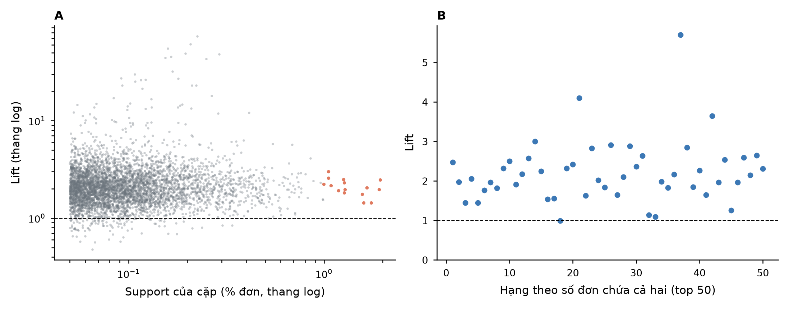

*Figure 25. A: support (% đơn, thang log) và lift (thang log) của 4.677 cặp có support ≥ 0,05%; chấm cam là 15 cặp có số đơn chứa cả hai cao nhất; đường nét đứt: lift = 1. B: lift của 50 cặp có số đơn chứa cả hai cao nhất theo hạng; đường nét đứt: lift = 1. Dữ liệu: 3.214.874 đơn `prior`, 300 sản phẩm phổ biến nhất.*

Nhận xét: 

- Trên toàn bộ 44.850 cặp, support và lift có tương quan thuận (ρ = 0,5607). Nhưng khi chỉ xét 4.677 cặp có support ≥ 0,05%, tương quan gần như bằng 0 (ρ = 0,0286). Nghĩa là trong các cặp phổ biến, support cao không đồng nghĩa với lift cao.
- Biểu đồ A: 15 cặp có số đơn cao nhất (chấm cam) nằm ở phía support cao nhưng lift chỉ 1,44 – 3,00, trong khi nhiều cặp support thấp hơn lại có lift cao hơn hẳn.
- Biểu đồ B: 49/50 cặp phổ biến nhất có lift > 1 và lift dao động 0,99 – 5,70; xếp hạng theo support và theo lift cho ra hai danh sách khác nhau (khớp với mục 15).
- Khoảng 80,33% số cặp (36.028/44.850) có lift > 1. Vì vậy, khi xây dựng luật kết hợp cần đặt ngưỡng cho cả support và lift (hoặc confidence), không nên chỉ dựa vào một chỉ số.

---

## 24. File sinh ra

| Đường dẫn                                                     | Nội dung                                                              |
| ------------------------------------------------------------- | --------------------------------------------------------------------- |
| `data/orders_prior.csv`                                       | Đơn hàng `eval_set == prior`                                          |
| `data/orders_train.csv`                                       | Đơn hàng `eval_set == train`                                          |
| `data/orders_test.csv`                                        | Đơn hàng `eval_set == test`                                           |
| `docs/figures/fig_eval_split.png` · `.pdf`                    | Figure 1 — số đơn theo eval_set                                       |
| `docs/figures/fig_missing.png` · `.pdf`                       | Figure 2 — tỉ lệ missing theo cột                                     |
| `docs/figures/fig_orders_per_customer.png` · `.pdf`           | Figure 3 — phân phối số đơn / khách                                   |
| `docs/figures/fig_order_timing.png` · `.pdf`                  | Figure 4 — ngày và giờ đặt hàng                                       |
| `docs/figures/fig_days_since_prior.png` · `.pdf`              | Figure 5 — khoảng cách giữa các đơn                                   |
| `docs/figures/fig_basket_size.png` · `.pdf`                   | Figure 6 — kích thước giỏ hàng                                        |
| `docs/figures/fig_basket_variation.png` · `.pdf`              | Figure 7 — biến động kích thước giỏ                                   |
| `docs/figures/fig_top_products.png` · `.pdf`                  | Figure 8 — sản phẩm phổ biến                                          |
| `docs/figures/fig_top_groups.png` · `.pdf`                    | Figure 9 — department/aisle phổ biến                                  |
| `docs/figures/fig_popularity_longtail.png` · `.pdf`           | Figure 10 — long-tail sản phẩm                                        |
| `docs/figures/fig_customer_diversity.png` · `.pdf`            | Figure 11 — đa dạng sản phẩm theo khách                               |
| `docs/figures/fig_reorder_products.png` · `.pdf`              | Figure 12 — mua lại theo sản phẩm                                     |
| `docs/figures/fig_reorder_groups.png` · `.pdf`                | Figure 13 — mua lại theo department/aisle                             |
| `docs/figures/fig_purchase_frequency_repurchase.png` · `.pdf` | Figure 14 — tần suất mua và mua lại                                   |
| `docs/figures/fig_recency_repurchase.png` · `.pdf`            | Figure 15 — recency và mua lại                                        |
| `docs/figures/fig_product_pairs.png` · `.pdf`                 | Figure 16 — cặp sản phẩm cùng đơn                                     |
| `docs/figures/fig_dataset_overview.png` · `.pdf`              | Figure 17 — quy mô bảng và số thực thể                                |
| `docs/figures/fig_department_popularity.png` · `.pdf`         | Figure 18 — độ phổ biến theo department                               |
| `docs/figures/fig_first_in_cart.png` · `.pdf`                 | Figure 19 — sản phẩm vào giỏ đầu tiên                                 |
| `docs/figures/fig_basket_by_time.png` · `.pdf`                | Figure 20 — kích thước giỏ theo ngày/giờ                              |
| `docs/figures/fig_customer_profile.png` · `.pdf`              | Figure 21 — hồ sơ khách hàng                                          |
| `docs/figures/fig_customer_segments.png` · `.pdf`             | Figure 22 — nhóm hành vi khách hàng                                   |
| `docs/figures/fig_reorder_rate.png` · `.pdf`                  | Figure 23 — tỉ lệ mua lại theo order_number và ngày                   |
| `docs/figures/fig_department_pairs.png` · `.pdf`              | Figure 24 — cặp department cùng giỏ                                   |
| `docs/figures/fig_support_vs_lift.png` · `.pdf`               | Figure 25 — support và lift của cặp sản phẩm                          |
| `docs/summary.json`                                           | Tóm tắt số liệu EDA cơ bản dạng JSON                                  |
| `docs/behavior_summary.json`                                  | Số liệu hành vi mua hàng dạng JSON (mục 3–7)                          |
| `docs/product_summary.json`                                   | Số liệu sản phẩm dạng JSON (mục 8–12)                                 |
| `docs/repeat_summary.json`                                    | Số liệu tần suất/recency/mua lại dạng JSON (mục 13–14)                |
| `docs/cooccurrence_summary.json`                              | Số liệu cặp sản phẩm cùng đơn dạng JSON (mục 15)                      |
| `docs/catalog_summary.json`                                   | Số liệu quy mô bảng, department, giỏ đầu dạng JSON (mục 0, 16–17)     |
| `docs/customer_summary.json`                                  | Số liệu giỏ theo thời điểm, khách hàng, mua lại dạng JSON (mục 18–21) |
| `docs/association_summary.json`                               | Số liệu cặp department và support–lift dạng JSON (mục 22–23)          |
| `src/analysis.py`                                             | Script tính số liệu (tách file, missing, distribution)                |
| `src/figures_paper.py`                                        | Script vẽ Figure 1–2                                                  |
| `src/eda_behavior.py`                                         | Script tính số liệu và vẽ Figure 3–7                                  |
| `src/eda_products.py`                                         | Script tính số liệu và vẽ Figure 8–13                                 |
| `src/eda_repeat.py`                                           | Script tính tần suất/recency và vẽ Figure 14–15                       |
| `src/eda_cooccurrence.py`                                     | Script tính cặp sản phẩm cùng đơn và vẽ Figure 16                     |
| `src/eda_catalog.py`                                          | Script tính số liệu và vẽ Figure 17–19                                |
| `src/eda_customers.py`                                        | Script tính số liệu và vẽ Figure 20–23                                |
| `src/eda_association.py`                                      | Script tính số liệu và vẽ Figure 24–25                                |

> Ghi chú: bản `.pdf` là vector, dùng để chèn thẳng vào báo cáo LaTeX/Word; bản `.png` (300 DPI) để xem nhanh trong Markdown.

### Mã LaTeX chèn figure (nếu cần)

```latex
\begin{figure}[t]
    \centering
    \includegraphics[width=\linewidth]{figures/fig_orders_per_customer.pdf}
    \caption{Phân phối số đơn hàng trên mỗi khách hàng (A: histogram; B: ECDF).}
    \label{fig:orders_per_customer}
\end{figure}
```
